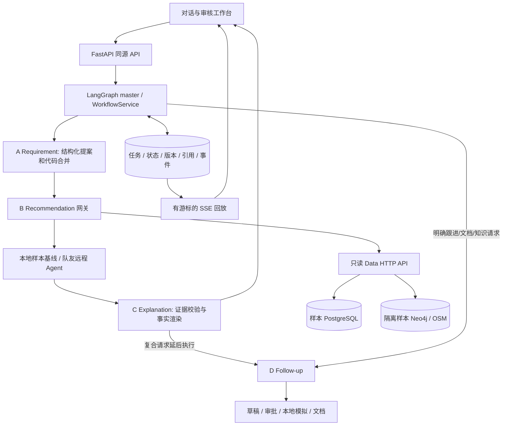

# V1.1 实现与运维说明

> 2026-10-20 更新：默认推荐已切换为江山原生模块，新增loopback 8092服务和独立SQLite状态。当前推荐接口以 `recommendation/contracts/` 为准；原有章节中的baseline公式/5条限额属于保留的基线模式。迁移、字段映射、真实验收和能力边界见 [原生接入说明](docs/Recommendation_Agent_原生接入说明.md)。

本实现依照 `D:\Real Estate Agent\design` 下的 V1.1 蓝图和 Recommendation Agent Contract V1。保留仓库既有 FastAPI → TypeScript LangGraph → PostgreSQL 架构，落实真实租赁业务，不另建一套 Python 编排。项目文档中的 Contract V1 是接口优先依据；原分工交接文档只用于理解职责。

## 1. 角色与执行链



`a.ts`、`b.ts`、`c.ts`、`d.ts` 是角色入口，共用 `createRoleRunner`，每个会话和角色使用独立 checkpoint。`master.ts` 复用原任务队列和恢复机制；`workflow.ts` 承担可测试的业务编排。角色不是四个可以任意调用外部服务的聊天窗口。

### Requirement Agent（A）

1. DeepSeek 通过结构化工具输出本轮增、删、改提案；代码校验 Zod 类型、字段单位和用户原文引用。
2. `rental-language.ts` 解析明确金额、户型、面积、比较符、枚举和否定。已确定的字面槽由代码拥有，模型不能覆盖、近似换算或追加多余澄清；模型补充尚未覆盖的维度，仍校验 schema、原文引用及删除授权，非法提案有限重试后显式失败。“必须/最好”的硬软属性、预算冲突等由代码裁决。`LLM_MODE=rules` 是用户可见的独立规则模式，不会在模型失败时偷偷切换。
3. 用户未指定软偏好相对重要性时由代码补 `weight=1`。明确权重非法时拒绝，不把它改成合法值。
4. `mergeRequirements` 保留未提及条件和稳定 `criterion_id`，只在完整结构化需求实际改变时增加 `requirements_version`。硬上限与软偏好可同时存在。
5. 裸“两房”、矛盾预算、面积无单位等歧义先澄清。“附近”则默认越近越好的软偏好，不要求半径/地标，默认直线口径并说明；只有实际目录无匹配或多义才追问位置。不能让模型用占位距离凑 schema；数据暂不支持的家具等要求仍保留，后续判 `unknown`。
6. 地点 ID 必须来自目录解析，不由模型猜测。目录覆盖 55 个规划区、5 大区、188 个站、613 个有效具名出口，并使用原 OSM 地点/校园目录。Clementi 区域和 MRT 是不同实体，中文、英文及受控别名均先解析成稳定 ID。
7. 同一轮连续修正保留尚未提交的原需求上下文；以新操作为准。上下文超过 32 条或 16,000 字符会明确拒绝，不静默丢弃早期条件。
8. 澄清中的最新回答单独解释，避免旧的模糊原句被反复判歧义；未回答的实际地点歧义不会因只修改预算而消失。新解析成功的 MRT/区域条件可解除旧版遗留的范围问题，合并之前暂存条件。交通方式补充更新原 commute_time，保留分钟上限。
9. “独立卫浴”使用既有 `amenities eq private_bathroom` 条件，不能由 bathrooms 数量证明，不增加未约定的 bathroom_type 字段。当前数据不支持时其判定为 unknown。通勤为 `commute_time` + `min`，未指明交通方式时不猜为公交。不同设施条件使用独立稳定 ID，避免互相覆盖。

10. `1B1B/2BR2BA/一室一卫` 为精确卧室和卫浴数量，不附加独卫、整租或人数。HDB room 型号不能直接当卧室数；CCR/RCR/OCR 是市场分区，不能混同 URA 五大区。取消独卫保留卫浴数量；多项设施存在时只按 ID 删除指定设施。

本次实际字段覆盖、120 条话术评估与 25 条独立 SQL 业务核对见 [租房需求语义评估与字段审计](docs/租房需求语义评估与字段审计.md)。缺证据原因分别显示数据未收录、记录缺失、路线工具未接入或实时状态未核实。

截图反馈的排查、修复与回归记录见 [需求抽取问题记录](evaluation/INTAKE_FIX.md)。

### Recommendation 边界（B）

最终算法及 Recommendation Agent 由崔江山负责。`RecommendationGateway` 支持：

- `baseline`：可运行的确定性联调实现；full 模式使用 SQL 分页完整扫描，不受旧 2,000 条限制，结果明确标注 `LOCAL_BASELINE`。
- `remote`：以 Contract V1 请求调用配置服务的 `POST /recommend`；同一逻辑重试保持相同请求 ID、完整请求体及 `Idempotency-Key`。

基线逐一评估样本中 475 条租赁候选，保留缺失字段，不先用会丢失 NULL 的 SQL 硬筛选。任一硬条件失败 → excluded；无失败且存在未知硬条件 → unverified；全部硬条件通过 → eligible。软条件只参与排序，不排除房源。

软条件分按权重归一：地点距离采用严格单调的 `pivot/(pivot+distance)`；无半径的附近默认 pivot=1000m，仅为评分尺度，不是硬筛选。单一距离偏好与按距离升序等价，避免旧线性公式在远处归零后出现大面积并列。其他正阈值数值 `lte` 使用 `clamp(1 - observed / (2 * threshold), 0, 1)`，一般条件通过为 1、否则 0。未知软数据贡献 0，仍保留声明的总权重分母。总分为贡献之和，范围 0–1；距离并列按租金、数字房源 ID 稳定打破并列。分数不是成交概率。研究与政策见 [地理推荐调研](docs/模糊需求与地理推荐调研及实施方案.md)。

反馈按事件 ID 去重并传入下一次请求，反馈更新使用新 `request_id`、可保持同一需求版本。本地基线**不执行行为兴趣重排**，会返回明确警告；没有把保存反馈等同于已实现队友的行为模型。无匹配时只建议有真实候选证据支持的调整，不自动修改预算或其他硬条件。

### Explanation Agent（C）

事实、排名、条件判定、预算余量和对比由代码从已校验结果生成。模型只能选择合法证据强调项，不能重新排房源、生成租金或补出可租事实。返回用户的解释包含源请求、需求版本、评估覆盖、通过/未知原因、证据引用和快照限制。总结复用同一事实模型，HTML 转义内容。

### Follow-up Agent（D）

用户从当前已验证列表选择房源后，可生成联系或看房草稿。序号绑定 `source_request_id` 和当前搜索操作，避免“第一套”误指旧列表。没有可信邮箱时要求人工填写核实，不虚构联系人。

动作状态：模拟分支 `DRAFT → PENDING_REVIEW → APPROVED → SIMULATED`；真实分支 `APPROVED → QUEUED → SENDING → ACCEPTED / FAILED / UNKNOWN`，回执和来信继续记录 `DELIVERED / READ / REPLIED`；看房另有双方确认后 `CONFIRMED`。未执行草稿可取消。审批绑定修订号与正文、联系人、房源、时间等内容哈希；编辑后审批失效。执行按动作/修订/类型建持久幂等键。看房必须为未来时间、起止合法、最多四小时；以客户和联系人共享日历键检测冲突。模拟提交不等于双方已确认，确认需两个明确标记及证据说明。

到期跟进提醒扫描数据库，通过唯一事件键防重复。提醒只出现在工作台，不自动发送外部消息。现已提供 WhatsApp Cloud API 和 Telegram Bot API 的可选真实执行器，默认 simulation。配置账号和渠道后，显式设置 `EXTERNAL_ACTION_MODE=live` 并重启，真实发送仍需当前修订审批。发送经过持久队列，平台受理、回执、回复与双方确认分别记录；超时结果不明时不自动重试。未连接 SMTP、销售 CRM 或外部日历。详细实现及申请步骤见 [Follow-up 工程文档](docs/Follow-up工程实现与验收.md)和[账号配置指南](docs/WhatsApp与Telegram申请配置指南.md)。

## 2. 可靠性设计

| 机制 | 对应实现及实际保证 |
| --- | --- |
| 原子状态推进 | `DomainStore` 的共享 SQL 事务同时写需求、结果消费记录、下一任务和事件；没有“状态更新了但下一任务没入队”的中间提交 |
| 防重复 | 用户消息 ID、任务步骤键、handled_results、反馈 ID、执行键分别去重；重复 ID 改内容会拒绝 |
| 防旧结果覆盖 | 活跃 operation + requirements_version + 最新 request_id 校验；反馈也会变化请求 ID，不能只比较需求版本 |
| 任务身份 | 输入/输出引用、角色、session、operation、任务状态和 SHA-256 校验；JSONB 对象键排序后计算稳定哈希 |
| 恢复 | 启动恢复原运行中任务、定时唤醒待办与未消费结果；已持久化结果可复用，不重复添加上下文 |
| 事件完整性 | 业务 SSE 只按数据库 event_id 顺序发送，避免 runtime 直接广播较大 ID 跳过已提交业务事件；断线从游标回放 |
| 引用隔离 | 会话以本机随机 Bearer 凭证所有权校验；跨会话证据、动作、文档不可读取 |
| 工具治理 | 角色权限先于缓存；缓存隔离用户/角色/数据版本；调用数、总时限、单次超时、熔断及实际调用追踪 |
| 输入与输出 | 请求 64KB 上限，query 8,000 字符；数据分页游标循环、重复实体、截断等明确检测；HTML/DOM 转义和同源 CSP |
| 复合流程 | “找房并总结”持久化依赖计划，A/B/C 完成并验证后才排 D；失败不生成伪结果文档 |

当前本机实例仅绑定回环地址。Bearer 凭证存在浏览器本地存储，适合课程项目本机演示；它不是已实现的生产账户、组织 RBAC 或服务间认证系统。清除浏览器存储会失去该浏览器保存的会话凭证，应先保存需要的总结。

## 3. 数据与空间证据

| 存储/端口 | 用途 | 当前数据 |
| --- | --- | --- |
| PostgreSQL 5432 / `multi_agent_assistance` | 应用状态与 checkpoint | 真实持久化会话、任务、证据、动作 |
| PostgreSQL / `propertyguru_sample` | 历史 CSV 样本 | properties 593、agents 162、images 19,097、price_history 1,665 |
| Neo4j 7475 / 7688 | 样本图谱，独立 volume | Listing 593、Place 3,716、NEAR_PLACE 62,029、HAS_NEARBY_PLACE 1,854、PART_OF_CAMPUS 362 |
| PostgreSQL / `propertyguru` | 当前完整历史快照库 | properties 21,431、agents 4,657、images 418,700、price_history 0 |
| Neo4j 7474 / 7687 | 当前正式完整图谱 | Listing 21,431、Place 3,716、NEAR_PLACE 710,468，含校园和官方位置目录 |
| 数据 API 8089 | 当前完整库的 SQL + Neo4j 只读服务 | 数据能力、完整评估扫描、详情、照片、地点与关系查询 |

`bootstrap_sample.py` 检查输入 CSV 哈希，规范负卧室哨兵为 NULL，以导出约定补 SGD，使用原数据模块同步图谱，写独立样本 manifest。样本 API 的 capabilities、ready 和 stats 返回样本元数据，不冒称完整快照日期。

OSM 是原地点数据源，Neo4j 保存 Place、校园组成和附近关系。新增官方 URA/LTA 目录和正式/样本图 GeoArea/GeoRegion/GeoStation/GeoExit 投影；完整库与样本房源的区域归属由真实多边形判断，不等于原邮区 IN_DISTRICT。基线使用 SQL 房源坐标与目录证据：点地点用 haversine，区域内距离=0、区外取最近边界距离，站点取最近已收录出口。`raw_distance_type=geodesic`、`distance_type=straight_line`，保留未舍入值做明确半径判断，`route_verified=false`，不转换成步行/公交时间。数据及刷新见 [地点目录](knowledge/locations/README.md)。

## 4. RAG、技能及外部工具

知识库位于 `knowledge/rental/*.md`，包含六篇官方租赁资料整理及两篇项目说明；不再使用旧JSON关键词FAQ。离线阶段 `python -m retrieval.index` 按标题、句子和换行打包为500字符块，使用本地多语言MiniLM向量写入Docker Chroma，完整成功后原子发布索引版本。在线阶段原问题加三条模型改写，Chroma余弦召回与中文BM25并行，经RRF（k=60）融合、模型重排后，按逐句摘录生成回答，核验chunk ID、原样引用、数字及语义支持。无依据时说明，故障时标明降级。完整设计、参数迁移差异、来源与验收见 `docs/Orchestrator与RAG重构记录.md`。

意图识别统一位于 `src/agents/orchestrator/`，参考EchoMind源码的70/20/10、每类三模板、每类一个few-shot、最近三条历史、0.5阈值及300秒缓存；远程识别期间不占数据库事务锁。RAG索引、来源日期、嵌入空间和答案引用均携带版本；知识问答不会改写Recommendation Contract V1或房源事实。

`skills/*/SKILL.md` 是应用运行时加载的角色技能，分别约束需求抽取、证据解释、销售跟进和看房协同。加载记录 SHA-256 进入 trace。技能补充业务指导，权限、审批和硬条件等由代码落实；修改技能不能解除执行器限制。它们不是 Codex 会话中安装的个人技能。

## 5. 新机器安装与本机运维

需要 Docker Desktop、Node.js 22.16+（本机实测 24.15）、Python 3.11+（本机实测 3.12.14）、Chrome 浏览器用于验收。

```powershell
Set-Location 'D:\Real Estate Agent\Multi-Agent-Assistance-System'
npm ci
python -m venv .venv
.venv\Scripts\python.exe -m pip install -r requirements-dev.txt
if (-not (Test-Path -LiteralPath '.env')) { Copy-Item -LiteralPath '.env.example' -Destination '.env' }
```

在 `.env` 填模型配置（不要提交真实密钥）：

```dotenv
CHAT_MODEL=openai:deepseek-flash
OPENAI_BASE_URL=https://api.deepseek.com
OPENAI_API_KEY=<在本机填写>
LLM_MODE=model
```

这里 `openai:` 表示兼容协议适配器，实际服务是 DeepSeek。`rules` 模式无需密钥、不能代表真实大模型验收。模型 ID 可用当前账户的 `/models` 查询确认，不能只依赖旧别名。

首次运行 `.\scripts\start-app.ps1`；以后 `.\scripts\start-app.ps1 -SkipDataImport`。应用端口 8010、图服务 3001、样本数据 8089。前端同时展示数据范围、模型、推荐和模拟状态。日志与进程记录在 `data/.runtime/`，全部被 Git 忽略。

修改后依次停止、启动。停止只针对本脚本记录的进程及其子进程，并验证创建时间以避免 PID 复用误杀。数据库停止/完整快照操作见 [部署记录](LOCAL_DEPLOYMENT.md)；不得使用 `down -v` 作为日常停止方式。

## 6. 切换队友推荐与完整数据

对接队友 B 时，设置 `RECOMMENDATION_MODE=remote` 和 `RECOMMENDATION_API_URL`，服务必须提供 `/recommend`。样本启动脚本会显式重设 baseline，因此正式远程联调应配置独立 full 环境或使用手工启动图服务的方式，不要误以为改一项变量会绕过样本配置。接口字段与 JSON Schema 说明见 [契约说明](contracts/releases/README.md)。

2026-10-20 已取得并安装 2026-10-09 完整快照，完成 PostgreSQL 导入、正式 Neo4j 投影、空间关系与 HTTP 验收。当前 `.env` 为 `DATA_MODE=full`，允许有明确标记的完整扫描 baseline；也可接队友 remote Agent。完整库实际评估 21,431 套租赁房源，见 [完整数据结构与接入说明](docs/完整数据结构与接入说明.md)。下表中的 sample 环境仍保留隔离，不再是当前默认查询源。

Full 的 `.env` 应明确设置 `DATA_MODE=full`、`DATASET_VERSION=2026-10-09`、完整只读数据连接、Neo4j 7687、正确 `DATA_API_URL`、`DATA_BUNDLE_MANIFEST_PATH` 指向成功验收报告，以及远程 B。然后使用 `.\scripts\start-app.ps1 -DataMode Full`。此模式会先执行完整验收；验收失败即停止，不落回样本。完整模式的最终真实业务验收仍需在完整数据和队友服务取得后执行。

## 7. 文件与团队交接

| 人员 | 本次可交接内容 |
| --- | --- |
| 孙哲徐 | Data API 适配器及样本 manifest；保留原 SQL / KG 模块，样本库与完整库隔离；需交付完整数据库与成功 verify |
| 崔江山 | Contract V1 完整快照请求、previous_state_id、反馈与执行校验；remote 网关；JSON Schema 和实际 baseline 响应可对照 |
| 周树晖 | A/C/D、master、状态事务、工具权限、知识边界、前端、文档与启动脚本 |
| 朗贺然 | 单元、PostgreSQL、真实模型业务与浏览器脚本；独立 SQL 和空间计算 oracle；报告、截图、尚未通过的完整快照项 |

推荐传输仍为 `contract_version=1.0`，内部任务 envelope 为 `schema_version=1.1`，两者含义不同。迁移 SQL 由运行时代码直接读取，不能只修改 SQL 副本却忘记实际 setup。
