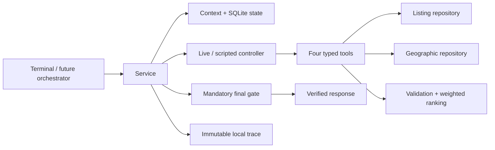

# Standalone recommendation subagent

Run from the repository root with Python 3.11+ and Node 20+. This module is separate from the existing A–D runtime; no agent role assignment, HTTP endpoint, frontend, or authentication was added.

```bash
python3.11 -m venv .venv
.venv/bin/python -m pip install -r dev/recommendationSubagent/requirements.txt
npm ci
.venv/bin/python -m dev.recommendationSubagent.terminal --data-mode fixture --controller scripted
```

At the prompt:

```text
requirements @dev/recommendationSubagent/examples/requirements.json
recommend
feedback-example /tmp/recommendation-feedback.json
feedback @/tmp/recommendation-feedback.json
recommend
show-state
show-trace
exit
```

Edit the generated feedback file to set sample durations before submitting it. Its IDs refer to the actual preceding response. `requirements` and `feedback` also accept multiline JSON terminated by `END`. A requirements submission replaces the full snapshot. Requirements versions advance only when that snapshot changes. Invalid input preserves accepted input and committed results. Feedback is staged until a successful non-error response commits it. Failed recommendations retain the same request/event identities for retries. `reset` creates a new conversation and retains historical data.

The banner prints the conversation ID. Resume it with `--conversation-id <id>` and the same `--state-path`. Committed requirements, profile, candidate pools, responses and traces survive restarts; **uncommitted terminal input is not saved on exit**. Responses print full listing details, scores, criterion outcomes and evidence, then export validated JSON beside the state database. `show-trace [request-id]` resolves immutable tool/model snapshots within the active conversation. The SQLite file is local debugging data; keep access restricted to its owner. No customer-facing trace endpoint is added.

## Database and live model execution

The root `.env` is loaded without overriding environment variables. Use the existing [PostgreSQL instructions](../../docs/preprocessing/postgresql.md) and [Neo4j instructions](../../docs/preprocessing/neo4j.md) to connect to the team's prepared stores. Do not run imports to launch this module. Do not substitute an empty new database for the fixed data snapshot.

| Configuration | Use |
| --- | --- |
| `PROPERTYGURU_READ_DATABASE_URL` | Preferred read connection to the listing PostgreSQL database |
| `PROPERTYGURU_DATABASE_URL` | Fallback listing connection, never the runtime's `DATABASE_URL` |
| `NEO4J_URI`, `NEO4J_DATABASE` | Bolt address and named database; database defaults to `neo4j` |
| `NEO4J_USER`, `NEO4J_PASSWORD`, `NEO4J_AUTH` | Existing graph authentication; explicit `none` supports the local development setup |
| `CHAT_MODEL` | Existing `provider:model` configuration, default `openai:gpt-4.1-mini` |
| `OPENAI_API_KEY`, `ANTHROPIC_API_KEY`, `GOOGLE_API_KEY` | Key for the selected existing provider |
| `OPENAI_BASE_URL` | Existing optional OpenAI-compatible endpoint |
| `RECOMMENDATION_STATE_PATH` | SQLite state and traces; default `dev/recommendationSubagent/.runtime/state.sqlite` |

```bash
.venv/bin/python -m dev.recommendationSubagent.terminal --data-mode database --controller live --check-connections
.venv/bin/python -m dev.recommendationSubagent.terminal --data-mode database --controller live --conversation-id conv-001
```

`check-connections` contacts both configured databases independently; its model check reports configuration only. Actual model execution occurs during `recommend`. Database and controller modes are independent and always printed. No failure silently switches to fixtures or scripted execution. The TypeScript bridge uses the existing `createModel` and provider SDKs, following [LangChain's model/tool-calling interface](https://docs.langchain.com/oss/javascript/langchain/models).

Generate a geography example from a place actually queried in the connected graph:

```bash
.venv/bin/python -m dev.recommendationSubagent.examples.live_geography > /tmp/geography-live.json
```

Then submit `requirements @/tmp/geography-live.json`. The chosen destination and 1,500 m radius remain unchanged even if no listings qualify. The checked-in `geography-fixture.json` is explicitly synthetic, not evidence of a live graph lookup.

## Service and contracts

```python
from dev.recommendationSubagent.repositories.connections import load_environment, repositories
from dev.recommendationSubagent.state.store import StateStore
from dev.recommendationSubagent.agent.controller import ScriptedController
from dev.recommendationSubagent.service import RecommendationService
from dev.sharedContract.recommendationSubagentContract.request import RecommendationRequest

load_environment()
listing, geographic = repositories('fixture')  # Select 'database' explicitly for live data.
service = RecommendationService(listing, geographic, StateStore('/tmp/recommendation.sqlite'), ScriptedController())
try:
    response = service.recommend(RecommendationRequest.model_validate(request_payload))
finally:
    service.close()
```

The shared package has no dependency on the implementation package. Its response is a typed generic envelope; concrete listing/score models stay in `models/`. Published schemas include all nested definitions and local `$ref` targets. Regenerate/check them with:

```bash
.venv/bin/python -m dev.recommendationSubagent.schemas
.venv/bin/python -m dev.recommendationSubagent.schemas --check
```

Validated initial, preference-update, feedback-only, success, clarification, no-match and error payloads live in `examples/contracts/`. Regenerate them with `examples.generate_contract_examples`. They use synthetic data. The example feedback request is tied to the accompanying example success response; runtime callers should generate fresh feedback from their own response.

The source of truth is the supplied requirements snapshot. The future orchestrator must retain the latest request ID and reject superseded responses. `previous_state_id` must match the latest conversation state; SQLite serializes updates across processes, and a server `run_sequence` orders feedback-only updates. Identical request retries return the immutable historical response after a replay gate, without applying events again. A changed payload with the same request ID is rejected, including after a failed attempt. Send a new ID to request refreshed facts.

## Data, geography and scoring

SQL reads `properties`, using parameterized RENT/keyset queries in a read-only repeatable-read transaction. All rental pages are retrieved, then cheap hard failures are removed in application code, retaining unknown values. A new request always retrieves again; this simple policy handles broader scope and source changes without unsafe cached-pool assumptions. Per-run normalized records/evidence are hashed and retained. The final gate re-reads the full listing scope and geographic evidence; relevant changes force bounded recomputation. This is not a cross-database transaction or a claim of present rental availability.

Neo4j reads integer `Listing.listing_id` (normalized to public string IDs), active `Place.place_id/name/category`, coordinates, and `NEAR_PLACE` facts. Category requests mean the nearest **known mapped** active place, not an exhaustive amenities inventory. Missing edges never mean no amenity exists. An edge is used only when its coordinates and distance agree with canonical coordinates; otherwise a Haversine calculation is explicitly labelled. Graph mapping status is reported separately. Stored relationship radius is coverage, not a search exclusion; typical graph coverage is 1,500 m. Unsupported walking/transit, furnishing, lease and availability requirements remain unsupported. Hard unknowns/unsupported facts cannot appear as verified recommendations. Campus buildings are individual OSM reference points, not campus identities or entrances; ambiguous names require an ID.

Explicit soft utilities use fixed policy: threshold match (0/1), geographic proximity `1/(1+d/r)`, or declared numeric minimize/maximize (fixed bounds: rent 0–20,000 SGD/month, bedrooms 0–10, area 0–10,000 sqft). Hard caps do not imply cheaper-is-better. Soft weights normalize once. Missing soft evidence contributes zero with the fixed denominator.

Implicit pairwise similarity uses property type .25, bedrooms .20 (scale 3), floor area .25 (500 sqft), listing-to-listing geography .30 (3,000 m). Missing features contribute zero and reduce reported coverage. Any explicitly specified feature is conservatively suppressed from the inferred feature set globally; district/destination requirements suppress implicit geography. This precedence policy is broader than detecting only direct contradictions and is visible in every score breakdown. No budget is inferred.

Completed sample durations are deduplicated by event and view-session IDs, summed per listing, capped at 120 seconds, then weighted by `log(1+t)/log(121)`. Zero weights mean no implicit signal. Both signals use .8 explicit/.2 implicit; one available signal gets weight 1; neither yields listing-ID ordering. One viewed listing's duration cancels in the normalized average. Every feature contribution, scale, unknown flag and effective weight is recorded. Defaults are versioned `weighted-v1`, not empirically optimized relevance parameters.

The controller has exactly four tools, at most eight model turns and twenty tool calls across repairs, a 90-second run budget, provider subprocess timeouts, and at most two final-gate repair attempts. Tool arguments can only identify canonical context. The application requires a recorded ranking prefix and materializes facts/scores itself. It invokes the gate even when the controller skipped validation. An operational failure remains `error`, not `no_match`. Full traces include actual messages, visible outputs, usage when reported, tool snapshots, candidate stages and gate attempts; hidden reasoning is never requested.



## Verification

```bash
.venv/bin/python -m dev.recommendationSubagent.examples.run
.venv/bin/python -m pytest dev/recommendationSubagent/tests dataPreprocessing/tests -q
.venv/bin/python -m unittest discover -s tests -p 'test_*.py'
npm run typecheck
npm run typecheck:recommendation
npm test
npm run build
```

See [assumptions and acceptance report](../../docs/recommendation/acceptance-notes.md) for observed results and outstanding live acceptance. See [preprocessing move map](../../docs/preprocessing/migration.md). Live acceptance remains a separate gate from offline tests.

## Application-owned runtime configuration

`--config path.json` (or `RECOMMENDATION_CONFIG`) loads a validated policy before creating the service. The checked-in `examples/config.json` contains the defaults. Python callers may pass `config=RecommendationConfig(...)` to `RecommendationService`.

```bash
.venv/bin/python -m dev.recommendationSubagent.terminal --data-mode fixture --controller scripted --config dev/recommendationSubagent/examples/config.json
```

The policy supports positive similarity scales, nonnegative global feature weights with positive total, and fixed numeric utility bounds. Set a feature weight to zero to disable it globally. The 80/20 fusion and duration interpretation remain unchanged. Modified policy values produce a deterministic `weighted-v1:<hash>` identifier; the exact configuration is retained with each state/trace. A new request uses the new policy, while a retried request remains an immutable historical replay under its original policy.

Execution limits can lower the eight model turns, twenty tool calls and two repairs, and configure the overall timeout (default 90 seconds). Deadline checks include final source refreshes; exceeding the deadline cannot commit a result. Model-facing candidate/ranking ID lists are bounded by `model_result_candidates` (default 100, minimum 4). Truncation flags and total counts accompany those summaries; full pools, scores and feature contributions remain in the immutable trace. This is presentation truncation only, not retrieval truncation.

## Repeatable acceptance companion

The acceptance runner supplements the interactive terminal and exports per-step requests/responses, state, a full trace and `acceptance.json`:

```bash
.venv/bin/python -m dev.recommendationSubagent.terminal.acceptance --data-mode fixture --controller scripted
```

For later live acceptance, configure the existing services and run the same module with its defaults (`database`/`live`), optionally selecting explicit `--requirements`, `--geography`, `--config` and `--output` paths. It checks initial search, a separate geographic input, sample feedback, duplicate events, an explicitly recorded stricter budget, trace access and state restart. It never relaxes the selected initial search to manufacture feedback targets. If no verified initial listings exist, feedback-dependent steps report blocked.

Reports distinguish overall status from live acceptance: offline runs always say `live_acceptance: not_run_offline`; unavailable live prerequisites say blocked. Exit codes are 0 for passed, 1 for failed, and 2 for blocked. A successful automated run still does not substitute for the interactive walkthrough, live outage exercise or teammate review.

## Small CSV dataset with real databases

The checked-in CSV can now be loaded into guarded empty local PostgreSQL/Neo4j stores without the full SQLite archive. See [CSV setup and manual testing](../../docs/testing/csv-sample.md). Use `examples/requirements-csv.json` and `examples/geography-csv.json` with `--data-mode database --controller scripted` to exercise real databases without a model key. These are separate, explicit sample inputs. Full-snapshot preprocessing verification is intentionally not applicable to this partial dataset.
