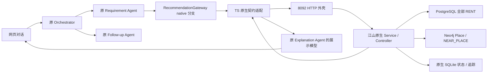

# 江山 Recommendation Agent 原生接入说明

2026-10-21 补充：真实浏览来源契约、主工作区详情及用户请求时使用兴趣已接入，见[真实浏览反馈实现与验收](真实浏览反馈_实现与验收.md)。以下原生迁移和验收记录对应2026-10-20基线；样例来源不再是当前唯一反馈来源。

实现日期：2026-10-20。对照的本地基线提交：`501fb6cdb0aa64bdbabb947324bf845654a9a269`；GitHub main 合并版本：`907cfa839d2665b3702450eb40acd4c96fe9296c`。以下描述当前代码的实际行为。

## 1. 对比结论与迁移原则

这次远端变化包含 145 个路径，不能只复制新增文件。已按内容检查同名 `.env.example`、`.gitignore`、`README.md`、`package.json`、`data/datasets/README.md`，并区分推荐模块、共享契约和数据目录迁移。完整清单、修改前后 SHA256、处理方式在 `evaluation/reports/recommendation-git-diff-audit.json`。

江山推荐逻辑在上游 `dev/recommendationSubagent/`，其输入/输出基础模型在 `dev/sharedContract/recommendationSubagentContract/`。它不是原先 TypeScript 确定性 baseline 的小幅增强，而是一套独立的 Python 原生 Agent：模型调用工具、完整候选池、显式/隐式评分、最终校验、反馈与持久状态。

本地保留原 `frontend/ → api/ → src/` 架构和 `data/` 模块，不套用远端 `dataPreprocessing/` 的整目录重命名。原生模块和契约共 71 个文件完整迁入 `recommendation/`；保留算法、参数、测试、样例、命令行和验收程序。新增 HTTP 外壳与 TS 适配器在原生核心之外实现。

允许的迁移变更只有：

1. Python 包名前缀从 `dev.recommendationSubagent` / `dev.sharedContract.recommendationSubagentContract` 改为 `recommendation` / `recommendation.contracts`。
2. ROOT 层级、Schema 目录、TS 模型桥路径和 `src/model.js` 相对导入路径按新目录调整。
3. 原有一项“只导入契约不得加载推荐实现”的测试，因契约现在也在 `recommendation` 命名空间，改为检查 `recommendation.service/agent/repositories/ranking` 不被加载；测试目标不变。

没有改写 `ranking/`、`validation/`、`context/`、`state/`、`service.py`、`tools/` 或控制器中的业务分支、计算公式、权重、阈值和预算。迁移白名单及逐文件指纹：`contracts/releases/recommendation-upstream-907cfa8.json`；检查脚本：`scripts/import-recommendation-upstream.py`。没有将外部错误隐藏成 baseline 成功。

## 2. 当前目录与调用路径

```text
src/agents/orchestrator/             原三路意图识别与编排，未改动
src/domain/workflow.ts               原 A → B → C / 直接 C、D 路由，未改动
src/domain/requirements.ts           原需求提取与增量合并，未改动
src/adapters/recommendation.ts       原网关，增加 native 模式分支
src/adapters/native-recommendation.ts 原生请求转换、调用、证据存档、展示投影
src/contracts/recommendation-native.ts 原生返回的 TS 结构校验
recommendation/
  app.py                            新增 HTTP 传输外壳
  contracts/                        江山 Request/Requirements/Feedback/Evidence/Response
    schemas/                        四份原生 JSON Schema
  models/                           ListingSummary、RecommendationItem、ScoreBreakdown
  repositories/                     PostgreSQL 完整读取、Neo4j 地理证据
  agent/controller.py               Scripted / Live 工具调用控制器
  agent/model_bridge.ts             复用项目 src/model.ts 的模型配置
  tools/dispatcher.py               四个工具与可信候选池
  ranking/                          显式、隐式、融合评分
  validation/                       逐项验证、最终重读、不可变重放校验
  context/                          反馈校验、去重、兴趣档案
  state/store.py                    原生 SQLite 事务与快照
  tracing/                          显式消息/工具结果/快照追踪
  terminal/                         原生命令行和8步验收
  tests/                            40项原有测试
frontend/native-ranking.js          原生分数说明、手动 sample 浏览事件
```

实际链路：



没有更换三路意图识别、RAG、技能加载、需求增量合并、跟进状态机或日历逻辑。Explanation 只增加原生评分的只读展示分支；B 的角色说明更新为已接入。新增的 `/feedback` 检查只约束 native sample 事件来源。

## 3. 江山原生推荐算法

### 3.1 工具与完整候选池

LiveController 使用项目 `.env` 中的模型。模型可调用四个固定工具：

| 工具 | 真实行为 |
| --- | --- |
| `retrieve_listings` | PostgreSQL 只读、可重复读事务，按主键每页500条读完所有 RENT；规范化缺失值、负数与房型大小写；先排除能由普通字段证明的硬失败 |
| `get_geographic_evidence` | 对保留候选获取所需地点与图边，计算可信直线距离 |
| `validate_hard_constraints` | 对每个候选、每条原生条件产生 pass/fail/unknown/unsupported |
| `rank_candidates` | 只给全部硬条件通过的候选打分，按 `(-combined_score, listing_id字符串)` 排序 |

模型只能引用当前 `context_ref`。排序、事实、候选来源及最后的返回前缀由代码决定，不能由模型自由编造。模型可见的候选ID预览默认最多100条、卡片预览4条，**不截断实际评分池**。

原参数保留：最多8轮模型调用、20次工具调用、90秒执行预算、最终校验最多2次修复重试；`result_limit` 为1—4。默认 `weighted-v1`，没有调低预算或用 ScriptedController 代替真实运行；scripted 仅用于明确标记的离线测试。

### 3.2 硬条件、未知与待核实

任意已知硬条件失败，候选不能进入验证推荐；所有硬条件必须 pass 才能打分与进入原生 recommendations。没有已知硬失败、但存在 unknown/unsupported 的候选进入 unverified_candidates，最多4条，**按原生候选顺序返回，原生不为它们提供分数**。

普通房源字段若缺失或非法，保留为未知。原生当前明确不支持 `commute`、`furnishing`、`availability`、`lease_months` 的验证；非 straight_line 距离没有路线证据，判 unsupported。

### 3.3 显式软偏好

只对 soft 条件计算显式匹配分，权重归一化。默认 threshold 的已知 pass/fail 效用为1/0；缺失或不支持贡献0，但仍计入完整权重分母。

`utility=proximity`：`u = 1 / (1 + 距离 / 参考尺度)`。参考尺度是效用曲线参数；soft 不因此成为硬半径。

`minimize/maximize` 使用原生固定区间归一化并截断到[0,1]：价格0—20000、卧室0—10、面积0—10000。应用原有条件未声明这种效用时，不擅自改成 minimize/maximize；原生 HTTP 和命令行仍完整支持它们。

### 3.4 浏览时长与隐式偏好

原生仅接受已完成、`source=sample` 的 `listing_view_duration`。事件必须引用当前会话过去一次原生返回中**已验证**的房源。按 event_id 与 view_session_id 去重；同ID不同内容报冲突。收藏、喜欢和负面评价不冒充浏览时长。

同一房源时长累计后最多120秒，兴趣权重为 `log(1+t) / log(121)`。候选与历史浏览房源计算四种相似度：

| 特征 | 原始权重 | 原始尺度 / 相似度 |
| --- | ---: | --- |
| 房型 | 0.25 | 规范化后完全相同为1，否则0 |
| 卧室数 | 0.20 | `max(0, 1 - 差值绝对值/3)` |
| 面积 | 0.25 | `max(0, 1 - 面积差/500)` |
| 地理位置 | 0.30 | `max(0, 1 - 两房源直线距离/3000)` |

**显式要求优先**：只要某特征已经由用户明确提出，无论硬软，就全局停用该特征的隐式推断。`district_code/distance/commute` 对应停用 geography。剩余特征权重重新归一化，未知特征贡献0并降低覆盖率；多套历史浏览房源按时长兴趣权重加权平均。

两类信号同时存在：`combined = 0.8 × explicit + 0.2 × implicit`。只有一种则该信号权重为1；都没有则分数0，按房源ID字符串稳定排序，不能说0分表示房源差。所有 Contribution、suppressed_features 和 evidence_coverage 均保留。

### 3.5 地理证据与最终校验

PostgreSQL 坐标为规范来源。Neo4j `NEAR_PLACE` 距离仅在图中房源坐标与规范坐标一致、边口径为 geodesic、与重新计算距离相差不超过1米时采用，否则使用坐标 haversine。没有图边不等于附近没有设施。类别查询取最近已收录地点；具体名称多义则未知，不任意选一个。

`final_gate` 重新读取完整 SQL 范围及本次地理证据，核对快照摘要、全部硬条件、模型返回是否正好是可信排序的前缀；变化则原生修复或明确失败。相同 request_id / 相同body返回不可变历史结果，用其原始快照执行 replay_gate；同ID改body拒绝。重放不宣称重新查询了今天的房源。

SQLite 保留 request_id 绑定、会话 state、runs、原始快照和可见模型/工具追踪。事务 `BEGIN IMMEDIATE` 保留；失败不提交新的反馈和偏好状态。

## 4. Requirement → 原生 Recommendation：字段映射

权威结构是 `recommendation/contracts/request.py`、`requirements.py`、`feedback.py`。A 的自然语言提取和原应用需求状态保持不动，在跨服务边界发送下表的原生字段。

| 原应用字段 | 发给原生字段 | 具体适配 |
| --- | --- | --- |
| contract_version | contract_version | 都为1.0，但两套结构不能混用 |
| request_id / conversation_id | 同名 | 原样保持，绑定会话与幂等 |
| requirements_version | 同名 | 应用允许0，原生最小1；映射 `应用版本+1`，响应展示映射回应用版本，存档保留原生值 |
| requirements.listing_type | 同名 | RENT |
| criteria[].criterion_id | 同名 | 稳定ID原样保留 |
| price / floor_area_sqft / property_type | 同名 | 价格SGD/month；面积sqft；房型依原生规则不区分大小写 |
| bedrooms | bedrooms | 原生是非负数，unit=null；不是旧接口的count单位 |
| district | district_code | eq/in和值不变 |
| place_proximity | distance | 原生unit=m；soft lte映射proximity，hard保持threshold |
| target.place_id / name / category | destination_id / destination_name / category | 原生必须恰好一个，优先稳定ID，其次类别，最后名称，不同时发送 |
| commute_time | commute | 原生unit=minutes；transport_mode必须walk/transit/drive；交通方式未指定则保留在应用未支持侧表 |
| lease_months | lease_months | 原生unit=months；保留原生unsupported结果 |
| furnishing | furnishing | 原生保留unsupported结果 |
| current_availability | availability | bool编码available/unavailable；原生仍unsupported，不据此宣称可租 |
| operator / value / strength | 同名 | 使用原生类型与比较规范；没有改硬条件阈值 |
| weight | weight | soft保留正权重；hard发送原生默认1，hard不参与软评分 |
| 无显式utility字段 | utility | 普通threshold；soft距离lte且尺度>0时proximity；不猜价格最小化 |
| previous_state_id | previous_state_id | 应用`native:<id>`解包；旧baseline状态不传进新引擎。应用传输入口按原生实际已提交head对齐；入站body与实际调用body分别留档，同一request_id只绑定一次 |
| result_limit | result_limit | 应用请求5，原生实际最多4；不是从5条结果中再截断重排 |
| active_view且payload.source=sample | listing_view_duration | ms→seconds，带原生来源request、完成会话ID和时间 |
| save / shortlist / explicit_attribute_feedback /普通浏览遥测 | 不伪造对应事件 | 保留本地原事件，并提示原生本轮未用于打分 |

**原生没有对应字段**：bathrooms、land_area_sqft、build_year、region_code、postal_code筛选、tenure_category、mrt_distance_m、mrt_walking_mins、rental_scope、move_in_date、amenities。注意 ListingSummary 可以返回邮编，但不代表原生支持邮编筛选。

这些原始条件保留在A状态及 native 交换存档中的 `unsupported_criteria`；不伪装成 furnishing 等其他字段，不用旧算法补算和补排。展示层为它们增加 unknown 结果；若为硬条件，将原生已选项标为“对完整用户需求仍待核实”，**不修改原生response**。这只是避免把未验证需求误报为已满足，不能声称原生已完成这类筛选。

原生请求示例：

```json
{
  "contract_version":"1.0",
  "request_id":"search-001",
  "conversation_id":"conversation-001",
  "requirements_version":2,
  "requirements":{"listing_type":"RENT","criteria":[
    {"criterion_id":"budget","field":"price","operator":"lte","value":3000,"unit":"SGD/month","strength":"hard","weight":1,"utility":"threshold"},
    {"criterion_id":"near-nus","field":"distance","operator":"lte","value":1000,"unit":"m","strength":"soft","weight":1,"utility":"proximity","destination_id":"OSM:way:54519165","distance_type":"straight_line"}
  ]},
  "feedback":[],
  "previous_state_id":null,
  "result_limit":4
}
```

## 5. 原生 Recommendation → Explanation

| 原生字段 | 当前承接方式 |
| --- | --- |
| 4个身份字段 | 校验与实际发出的原生请求一致；应用需求版本仅在投影层解码 |
| status | 原值保留在`native.status`和原生存档。已有待核实卡片时，兼容层使用原应用可进入C的no_match/success状态，使用户能看到卡片；不覆盖原生判定 |
| recommendations[].listing | 从原生ListingSummary转换title、price、bedrooms、district、url、area、property_type；不从模型正文取事实 |
| recommendations[].rank | 保持原生顺序；兼容层分组仅作完整需求的验证保护，不重新评分排序 |
| scores | `native.scores[listing_id]`保留整个ScoreBreakdown；卡片/解释展示显式分、隐式分、融合权重、覆盖率和停用特征 |
| criterion_results | 原始四态结果保留在native元数据/存档；老UI的unknown对应原生unknown或unsupported，原因明确区分 |
| evidence / evidence_refs | 原样保存在交换存档。UI按同一次快照补齐普通字段的可点击来源，source_ref为当前会话持有的本地UUID，不把外部trace字符串冒充本地引用 |
| strengths / trade_offs / unknowns | 原生字段不丢失；兼容解释按同一criterion_id的结果构造，额外应用条件保持unknown |
| unverified_candidates | 只带ID和逐项结果；HTTP外壳从该次不可变原生pool补充ListingSummary，不重新查询另一个排名，不补评分 |
| clarifications / relaxation_suggestions / warnings | 原生字符串完整留档，warnings也进入兼容展示；不自动执行放宽建议，不改写用户要求 |
| state | 原生state/run_sequence/feedback_version/scope/count等全部留档；兼容state使用`native:<state_id>`，coverage仅针对已安装数据集 |
| execution | 原生trace、策略、模型/工具调用数、耗时、tokens、数据/控制模式和评分版本全量留档；兼容execution保留可解析归档引用 |
| error | 原生错误原样传递业务失败；无baseline回退 |

`native.exchange_ref` 是会话隔离的完整交换存档。通过原有 `/api/evidence?session_id=...&ref=...` 读取，已有owner校验；存档包含 **request、response、presentation、unsupported_criteria、ignored_feedback**。原生HTTP `/recommend` 直接返回原生Response；`/app/recommend` 外壳增加 presentation，不污染原生response本身。

原生单项返回结构示意（非完整报文，完整可执行示例见 `recommendation/examples/contracts/`）：

```json
{
  "listing":{"listing_id":"500281070","title":"…","price":2600,"property_type":"condominium","source":"postgresql:properties"},
  "rank":1,
  "scores":{
    "explicit_score":0.5100237534890987,"implicit_score":null,
    "combined_score":0.5100237534890987,"explicit_weight":1,"implicit_weight":0,
    "evidence_coverage":1,"contributions":[],"suppressed_features":["geography"],"ordering":"explicit"
  },
  "criterion_results":[{"criterion_id":"nus-radius","outcome":"pass","reason":"…","evidence_refs":["…"]}],
  "evidence_refs":["…"],"strengths":["nus-radius"],"trade_offs":[],"unknowns":[]
}
```

## 6. 运行、状态与安全边界

当前网页仍是 `http://127.0.0.1:8010/`，图服务3001，数据API8089，RAG8091，新原生推荐服务8092。`.env` 已设置 native / database / live；使用原有模型配置，不另外硬编码服务商或密钥。

新依赖已纳入根 `requirements.txt`，包含原生 requirements。标准启动/停止脚本会一并管理推荐服务；`restart-component.ps1 -Name recommendation` 可单独重启。内部token由启动脚本在缺失时生成，只保存在被忽略的.env；8092绑定loopback，两个POST入口均要求 `X-Recommendation-Token`，不给浏览器暴露token。

HTTP外壳在执行线程创建SQLite连接，避免跨线程复用；外部排队后才进入原生事务；客户端断连不提前释放执行锁。传输重试使用相同body/request_id，仍由原生幂等机制决定结果。没有更改原生并发事务语义。模型单次执行默认90秒，网关HTTP预算150秒含排队和传输。大候选池及快照较大，原生追踪SQLite需要保留磁盘空间。

应用可能已放弃某次搜索，但其原生执行稍后才完成提交。此时网页持有的previous_state会落后。`/app/recommend`外壳只在新请求第一次绑定时，读取原生已提交head并填写原生previous_state；绑定保存于外壳管理的`app_transport_requests`表，重试不再重新选择head。criteria、版本、feedback均不改写；原生`prepare/reserve/final_gate`仍原样执行。直接`/recommend`继续严格拒绝过期引用，不启用此应用适配。`transport_request`与实际`request`同时归档，不隐瞒引用对齐。

前端对未变化的不可变推荐快照保持卡片DOM，避免解释/消息SSE刷新恰好替换点击中的卡片。这个修改只影响渲染，不改变Agent编排或房源顺序。

状态位于 `data/.runtime/recommendation/state.sqlite`，与原应用PostgreSQL状态相互独立。备份/迁移时要同时保留，否则原生会拒绝未知 previous_state_id，不能假装恢复历史兴趣。所有`.runtime`、密钥和1GB原始数据库仍在gitignore内。

Windows手工运行原生CLI建议：

```powershell
$env:PYTHONUTF8='1'
.venv\Scripts\python.exe scripts/run-recommendation.py --check-connections
.venv\Scripts\python.exe scripts/run-recommendation.py --data-mode database --controller live
```

启动器在不修改原生 `load_environment(override=False)` 的情况下，采用与本应用相同的“.env优先”规则，避免桌面进程继承的旧provider凭证覆盖当前配置。没有把一次旧环境凭证失败报告成模型已通过；调整启动环境后已完成实际验收。

## 7. 已验证结果及限制

| 验证 | 实际结果 / 报告 |
| --- | --- |
| 原始目录的40项pytest | 40通过 |
| 迁移后的40项pytest | 40通过；新增HTTP传输测试另1项通过 |
| 71文件来源校验 | 通过，只有迁移白名单内的命名/路径/测试命名空间调整 |
| 两套引擎输出对比 | 初次、行为融合、重复事件、收紧条件、重放、重启和final_gate一致；仅忽略UUID与耗时等非确定值，见 `native-upstream-parity.json` |
| 完整SQL业务对照 | 21,431条；D05/≥2房/≤5000：161通过、6待核实、21264排除，原生4条排名与独立SQL及ID排序一致 |
| 行为重排独立计算 | 原生浏览时长带来的候选相似度与分数、停用特征、排名一致；反馈不重复计数 |
| 地理独立核对 | D05/≤3000/NUS三公里：180通过；前4条距离与 `1/(1+d/1000)` 分数一致，见 `native-geographic-oracle.json` |
| 原生8步真实验收 | PostgreSQL + Neo4j + 配置的DeepSeek，全部通过，见 `native-original-live-acceptance.json` |
| 应用端到端 | 搜索、直接解释、看房草稿、总结、浏览反馈、照片与周边、幂等重放通过，见 `native-integration-live.json` |
| 原编排与RAG回归 | 真实知识问答、搜索、直接C、直接D、日总结、会话隔离通过，见 `orchestrator-rag-workflow.json` |
| 浏览器 | 见 `native-ui.json` 和 native-desktop/native-mobile截图；包含实际输入解释、浏览样例重排及看房跟进 |

不能承诺的新旧能力等价处：

- 原生只有10类输入字段；上述缺失字段明确保留为应用待核实条件。这不会获得旧基线对这些字段的过滤能力。
- 原生仅能解析Neo4j中active的OSM Place点位。原应用55个URA规划区和LTA出口目录仍存在、Requirement仍能解析名称，但原生地理仓库不消费它们。当前有明确能力提示，不任意改成区中心或另一地标；如需原生支持多边形/出口集合，应与江山确认独立后续版本，不能本次悄改算法。
- 原生待核实候选没有评分；保持其返回顺序。应用附加硬条件把原生已选项转为待核实时，仍保留原生得分和原始分组元数据；合并展示可能有最多8张待核实卡片，原生仍是每组最多4条。
- sample浏览是课程测试输入，界面明确标注为手动样例，不宣称自动采集真实用户行为；收藏不参与原生兴趣模型。
- 数据为历史快照，当前可租和真实路线仍不能从历史字段推断。

## 8. 重跑检查

```powershell
npm run typecheck:recommendation
npm test
.venv\Scripts\python.exe -m pytest recommendation/tests tests/test_native_transport.py -q
.venv\Scripts\python.exe -m recommendation.schemas --check
.venv\Scripts\python.exe scripts/import-recommendation-upstream.py --check
$env:NATIVE_LIVE='1'
node --env-file=.env --import tsx --test tests/native-recommendation-live.test.ts
$env:NATIVE_GEO_LIVE='1'
node --env-file=.env --import tsx --test tests/native-geography-live.test.ts
$env:PYTHONUTF8='1'
.venv\Scripts\python.exe scripts/run-recommendation.py --acceptance --data-mode database --controller live --requirements recommendation/examples/requirements-csv.json --geography evaluation/inputs/native-full-geography.json --output data/.runtime/native-acceptance-current
.venv\Scripts\python.exe scripts/test_native_recommendation_ui.py
```

旧测试中专门断言baseline的5条、按价格破同分或旧评分公式的真实验收，仍仅适用于显式baseline配置，不应拿来要求原生输出改变。通用单元测试和原编排回归继续运行；新增原生验收使用独立业务期望，而不只检查字段存在。
