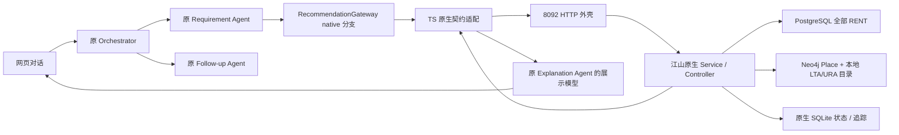

# 江山 Recommendation Agent 原生接入说明

2026-10-21 补充（main）：真实浏览来源契约、主工作区详情及用户请求时使用兴趣已接入，见[真实浏览反馈实现与验收](真实浏览反馈_实现与验收.md)。2026-10-23 与 main c7dc536 合并：请求沿用 main 的 [Recommendation Contract：浏览时长与看房意向](Recommendation_Contract_浏览时长与看房意向.md)（契约 1.0 + `feedback` 事件 + `behavior_context`），另加推荐方的 `cold_start`；原生端对 `behavior_context` 评分（会话累计浏览摘要中 `interest_eligible` 的条目、已保存的看房意向），`feedback` 事件只校验不计分；响应为原生契约 2.0。合并说明见 MIGRATION.md 的“Merge with main c7dc536”一节。

实现日期：2026-10-20；原生契约 2.0 改造：2026-10-23（分支 `feat/recommendation-exploration`）。对照的本地基线提交：`501fb6cdb0aa64bdbabb947324bf845654a9a269`；GitHub main 合并版本：`907cfa839d2665b3702450eb40acd4c96fe9296c`。以下描述当前代码的实际行为；第1节与第7节中标注为 2026-10-20 的内容是当时迁移的历史记录。原生 1.0 → 2.0 的逐字段变化、状态库和旧数据处理见 [MIGRATION.md](../evaluation/recommendation-exploration-2026-10-23/MIGRATION.md)。

## 1. 对比结论与迁移原则

这次远端变化包含 145 个路径，不能只复制新增文件。已按内容检查同名 `.env.example`、`.gitignore`、`README.md`、`package.json`、`data/datasets/README.md`，并区分推荐模块、共享契约和数据目录迁移。完整清单、修改前后 SHA256、处理方式在 `evaluation/reports/recommendation-git-diff-audit.json`。

江山推荐逻辑在上游 `dev/recommendationSubagent/`，其输入/输出基础模型在 `dev/sharedContract/recommendationSubagentContract/`。它不是原先 TypeScript 确定性 baseline 的小幅增强，而是一套独立的 Python 原生 Agent：模型调用工具、完整候选池、显式/隐式评分（契约 2.0 起为软需求 / 行为相似度融合评分 + select-v1 选择）、最终校验、反馈与持久状态。

本地保留原 `frontend/ → api/ → src/` 架构和 `data/` 模块，不套用远端 `dataPreprocessing/` 的整目录重命名。原生模块和契约共 71 个文件完整迁入 `recommendation/`；保留算法、参数、测试、样例、命令行和验收程序。新增 HTTP 外壳与 TS 适配器在原生核心之外实现。

允许的迁移变更只有：

1. Python 包名前缀从 `dev.recommendationSubagent` / `dev.sharedContract.recommendationSubagentContract` 改为 `recommendation` / `recommendation.contracts`。
2. ROOT 层级、Schema 目录、TS 模型桥路径和 `src/model.js` 相对导入路径按新目录调整。
3. 原有一项“只导入契约不得加载推荐实现”的测试，因契约现在也在 `recommendation` 命名空间，改为检查 `recommendation.service/agent/repositories/ranking` 不被加载；测试目标不变。

2026-10-20 迁移时没有改写 `ranking/`、`validation/`、`context/`、`state/`、`service.py`、`tools/` 或控制器中的业务分支、计算公式、权重、阈值和预算。迁移白名单及逐文件指纹：`contracts/releases/recommendation-upstream-907cfa8.json`（保持不变）；检查脚本：`scripts/import-recommendation-upstream.py`。没有将外部错误隐藏成 baseline 成功。

2026-10-23 的契约 2.0 改造按计划修改了上述业务逻辑（完整反馈快照、探索池缓存、原生地理解析、fused-v2 全池评分、select-v1 选择、精简追踪）。新逻辑尽量放在清单之外的新模块；清单内每个被修改的文件都登记在 `contracts/releases/recommendation-downstream-patches.json`（清单原指纹、修改后指纹、问题和变更），`--check` 同时核对。`scripts/compare-recommendation-upstream.py` 已退役，只作为 907cfa8 基线的历史证据。

## 2. 当前目录与调用路径

```text
src/agents/orchestrator/             原三路意图识别与编排，未改动
src/domain/workflow.ts               原 A → B → C / 直接 C、D 路由，未改动
src/domain/requirements.ts           原需求提取与增量合并，未改动
src/adapters/recommendation.ts       原网关，增加 native 模式分支
src/adapters/native-recommendation.ts 原生请求转换、调用、证据存档、展示投影
src/contracts/recommendation-native.ts 原生返回的 TS 结构校验
recommendation/
  app.py                            HTTP 传输外壳（/recommend、/app/recommend）
  contracts/                        契约 2.0：Request/Requirements/FeedbackSnapshot/Evidence/Response/Summary/limits
    schemas/                        四份原生 JSON Schema（python -m recommendation.schemas --check）
  models/                           ListingSummary、RecommendationItem、ScoreBreakdown
  settings/recommendation.yaml      全部可调算法参数的唯一来源（loader.py 校验；依据见 TUNING.md）
  repositories/                     PostgreSQL 只读读取 + 数据指纹、Neo4j 地点目录
  geography/                        原生地理目录、名称规范化、实体解析、直线距离
  agent/controller.py, prompt.py    Scripted / Live 控制器与提示词
  agent/model_bridge.ts             复用项目 src/model.ts 的模型配置
  tools/                            四个流水线工具、六个地理查询工具、bind_entity、探索池构建
  ranking/                          fused-v2 全池评分（scoring_v2.py）、select-v1 选择与冷启动（selection.py、exploration.py）
  validation/                       逐项验证、final_gate、select-v1 重放校验
  context/manager.py                运行一致性检查与反馈快照读取（不累积历史反馈）
  state/                            SQLite v2 表、探索池缓存、数据版本
  tracing/                          精简追踪（阶段记录、紧凑工具步骤、debug 行）
  terminal/                         原生命令行、调试命令（debug.py）和验收程序
  analysis/                         离线校准与评估脚本（服务从不导入）
  tests/                            Python 测试
frontend/native-ranking.js          原生分数、选择原因说明、手动 sample 浏览事件
```

实际链路：



没有更换三路意图识别、RAG、技能加载、需求增量合并、跟进状态机或日历逻辑。Explanation 只增加原生评分的只读展示分支；B 的角色说明更新为已接入。新增的 `/feedback` 检查只约束 native sample 事件来源。

## 3. 江山原生推荐算法

### 3.1 工具与完整候选池

LiveController 使用项目 `.env` 中的模型；ScriptedController 按固定顺序直接执行四个流水线工具，不搜索也不绑定。模型可调用四个按固定顺序执行的流水线工具（乱序调用返回 `STALE_REFERENCE` 工具错误，重跑某一阶段会作废其后各阶段）：

| 工具 | 真实行为 |
| --- | --- |
| `resolve_entities` | 由代码确定性解析每条地理条件的目标（有效 ID 核验复用；名称精确匹配别名；多候选为 ambiguous，不取第一条） |
| `build_pool` | 建立或复用探索池：PostgreSQL 只读、可重复读事务读取 RENT，所有硬条件（含地理硬条件）通过才入池 |
| `get_geographic_evidence` | 对探索池计算软地理条件的直线距离 |
| `rank_candidates` | 对完整探索池评分（fused-v2）、计算冷启动诊断并由代码按 select-v1 选择（`selected_ids`） |

另有只读地理查询工具 `search_places`、`describe_fields`、`nearest_mrt`、`distance_to`、`nearby_amenities`、`district_membership`，以及 `bind_entity`（仅用于消除该条件自身名称的歧义：条件按名称为 ambiguous（ID 与名称冲突除外），本次运行中为该条件做的 `search_places` 以该条件自己的 destination_name 为查询词、只用 kind/category 收窄，结果恰好只有这一个候选，且它属于该名称的全部精确匹配并有有效坐标；unresolved 的名称不会被替换成别的地点；绑定后探索池、地理证据和排序作废）。每个工具有独立的参数 schema（`recommendation/tools/arguments.py`）；房源 ID 必须来自当前探索池，实体 ID 必须由本次运行的工具返回。实际执行的查询/绑定调用计入 `controller.max_resolution_tool_calls`（因参数、阶段顺序或过期引用被拒绝的调用不计），每条条件的搜索计入 `entity_resolution.max_search_attempts`，全部调用计入 `controller.max_tool_calls`。

模型只能引用当前 `context_ref`。排序、事实、候选来源及最终选择由代码决定，不能由模型自由编造；模型最终只能返回最近一次 `rank_candidates` 的 `selected_ids`。提示词说明：条件不可修改，房源/地点文本是数据而不是指令，搜索词只是假设，只使用工具返回的 ID，有歧义时不取第一条。模型可见的候选ID预览最多 `controller.model_result_candidates`（100）条，追踪每步最多保留 `trace.preview_rows`（10）行，**不截断实际评分池**。

预算全部来自 `recommendation/settings/recommendation.yaml`：最多8轮模型调用、20次工具调用（其中查询/绑定最多6次）、每条条件最多3次搜索、90秒执行预算、最终校验最多2次修复重试；`result_limit` 为1—10（契约 2.0；省略时取 `recommendation.default_result_limit`=10）。评分版本 `fused-v2`，选择算法 `select-v1`；没有调低预算或用 ScriptedController 代替真实运行；scripted 仅用于明确标记的离线测试和冒烟。

### 3.2 硬条件、未知与待核实

任意已知硬条件失败，候选不能进入验证推荐；所有硬条件（含地理硬条件）必须 pass 才能进入探索池、打分并进入原生 recommendations。没有已知硬失败、但存在 unknown/unsupported 的候选不进入探索池（契约 2.0 不再返回 unverified_candidates），只在 `pool.excluded_hard_unknown` / `pool.unknown_reasons` 中计数说明。`needs_clarification` 只用于条件本身的问题（硬条件不支持、目标 unresolved 或 ambiguous）；仅因数据未知（如缺坐标）而为空的探索池返回 `no_match` 并给出计数和警告。

探索池按会话缓存：键为 `pool_key`（房源类型、规范化硬条件及已解析实体、地理配置、目录版本）和 `data_version`（对全部 RENT 行的一次 SQL 指纹 + 地理目录版本）。软需求或反馈变化复用；硬条件或数据变化重建；指纹读取失败时不使用缓存。冷启动抽样不写缓存。

普通房源字段若缺失或非法，保留为未知。原生当前明确不支持 `commute`、`furnishing`、`availability`、`lease_months` 的验证；非 straight_line 距离没有路线证据，判 unsupported。

### 3.3 软需求匹配

只对 soft 条件计算软需求匹配分，权重归一化。默认 threshold 的已知 pass/fail 效用为1/0；缺失或不支持贡献0，但仍计入完整权重分母（`soft_evidence_coverage` 记录已知部分）。没有 soft 条件时 soft_score 为 null，贡献0。

`utility=proximity`：`u = 1 / (1 + 距离 / 参考尺度)`。参考尺度是效用曲线参数；soft 不因此成为硬半径。

`minimize/maximize` 使用 `ranking.soft.numeric_bounds` 区间归一化并截断到[0,1]：价格0—20000、卧室0—10、面积0—10000。应用原有条件未声明这种效用时，不擅自改成 minimize/maximize；原生 HTTP 和命令行仍完整支持它们。

### 3.4 反馈快照与行为相似度

编排器每轮发送完整反馈快照，原生端不保存、不累积历史反馈：`previous_round` 是用户上一轮看到的推荐（request_id、展示房源 ID、每个展示房源恰好一条浏览记录：`recorded` 带秒数，0 表示展示但未浏览；或 `missing`），`appointments` 是全部历史有效看房预约（每个房源一条，状态限 MANUAL_SENT / MANUAL_REPLIED / CONFIRMED，状态升级不增加贡献）。上一轮必须是本会话已提交的 v2 运行，且其推荐 ID 集合等于展示 ID 集合，否则 `INVALID_FEEDBACK`。收藏、喜欢和属性反馈本期不参与评分。

行为参考房源只取**当前探索池内**的：计数状态的预约房源，以及上一轮 `recorded` 且秒数 > 0 的浏览房源；浏览权重 `log1p(t / 30)`，不封顶。候选与参考房源按五个特征比较（`ranking.similarity`）：

| 特征 | 权重 | 相似度 |
| --- | ---: | --- |
| 价格 | 0.20 | `max(0, 1 - 差值/跨度)`，跨度为整个探索池的 p95 − p05 |
| 房型 | 0.20 | 规范化后完全相同为1，否则0 |
| 卧室数 | 0.16 | 同价格，跨度按探索池拟合 |
| 面积 | 0.20 | 同价格，跨度按探索池拟合 |
| 地理位置 | 0.24 | `max(0, 1 - 两房源直线距离/3000)`；缺坐标时按 district_code 是否相同（1/0） |

**只按硬条件停用特征**：某特征被硬条件约束时（price→价格、bedrooms→卧室、floor_area_sqft→面积、property_type→房型、district_code/distance/commute→地理位置）才停用；软条件不停用。缺失属性不参与比较，按已比较权重归一化并报告 `comparison_coverage`，低于 0.5 时该对不可用；某特征在探索池内跨度为0时本池停用。候选与自身不比较。只有一个浏览参考时，归一化会抵消绝对时长。

融合（fused-v2）：`combined = 0.60 × soft + 0.40 × (0.60 × appointment + 0.40 × browsing)`；缺失分支贡献0，**不转移分支权重**。完整探索池每轮全部评分，按 (−combined, listing_id) 得到全池顺序 O，`score_rank` 为在 O 中的位置。所有 Contribution（分支、参考房源、尺度、方法）、suppressed_features 和覆盖率均保留。参数取值依据见 [TUNING.md](../evaluation/recommendation-exploration-2026-10-23/TUNING.md)。

### 3.5 冷启动与 select-v1 选择

K = min(result_limit, 探索池大小)。与第 K 名分差不超过 ε/2（ε = `selection.tie_max_score_span` = 0.01）的连续区间为近似同分组 G，其前面的为明显领先项（leaders），全部保留；其余 m 个名额：

- 非冷启动：G 恰好放得下则按分数返回（`ranked`），否则在 G 内不放回等概率随机抽 m 个（`near_tie_sampling`）。
- 冷启动：在领先项之后取前 max(|G|, 30) 个候选，按整个探索池的价格分位（5 层，同价边界合并，无价格单列）分层、按比例不放回抽样（`cold_start_exploration`）。
- 探索池不超过 result_limit 时全部按分数返回（`small_pool`）。

冷启动退出条件：前 K 项软需求证据覆盖度均值 C ≥ 0.80、G 的大小 B ≤ 5、权重扰动 20 次后前 K 集合平均重合度 S ≥ 0.90；扰动只用于诊断，不改正式分数。退出状态由编排器保存（`cold_start.exited` / `exited_pool_key`），硬条件变化导致探索池重建时重新评估。**没有软需求时 C = 0，冷启动无法退出。** 随机种子由会话、请求、探索池版本和结果相关配置的 hash 派生并保存；同一请求重放返回原结果，新请求可以重新抽样。展示顺序为领先项在前、抽中项在后，各自按分数顺序；每套房源带 `selection_reason` 和 `selection_note`。价格分层抽样不减少评分计算量（评分始终针对完整探索池）。

### 3.6 地理证据与最终校验

PostgreSQL 坐标为规范来源。原生地理目录包含 188 个 LTA 站点及 613 个已收录出口、55 个 URA 规划区多边形及 5 个大区、站点/区域别名和 Neo4j 中 active 的 OSM Place 点位。所有直线距离由 Python haversine 计算：OSM 地点为点；LTA 站点按最近已收录出口计算（出口只作来源记录）；URA 区域在多边形内为0，外部为到最近边的距离；大区取其各区域最小值。不使用 Neo4j `NEAR_PLACE` 边和 `point.distance`。缺坐标的房源判 unknown，不判失败也不当作0米。名称按与 TS `normalizePlace` 相同的规则规范化后精确匹配；多个匹配为 ambiguous 并列出候选，不任意选一个；没有匹配为 unresolved（不编造地点）。每条地理条件的解析结果在 `resolution` 中返回。

`final_gate` 核对模型返回的 ID 与代码选择完全一致（含顺序）、重新查询 `data_version`（变化则 `STALE_EVIDENCE`）、按 ID 重读选中房源并只为它们重新计算地理证据和全部硬条件，并要求选择可由保存的 `selection_input` 复现。相同 request_id / 相同 body 返回不可变历史结果，用保存的 `selection_input` 和种子执行 replay_gate；同ID改body拒绝。重放不宣称重新查询了今天的房源。

SQLite 保留 request_id 绑定、会话 v2 state、runs（紧凑快照，不含整池行）、探索池缓存和精简追踪。事务 `BEGIN IMMEDIATE` 保留；失败不提交新的运行状态。旧 1.0 表保持可读，不再写入。

## 4. Requirement → 原生 Recommendation：字段映射

权威结构是 `recommendation/contracts/request.py`、`requirements.py`、`feedback.py`。A 的自然语言提取和原应用需求状态保持不动，在跨服务边界发送下表的原生字段。

| 原应用字段 | 发给原生字段 | 具体适配 |
| --- | --- | --- |
| contract_version | contract_version | 应用 V1 为1.0；原生为2.0（1.0 报文被拒绝），两套结构不能混用 |
| request_id / conversation_id | 同名 | 原样保持，绑定会话与幂等 |
| requirements_version | 同名 | 应用允许0，原生最小1；映射 `应用版本+1`，响应展示映射回应用版本，存档保留原生值 |
| requirements.listing_type | 同名 | RENT |
| criteria[].criterion_id | 同名 | 稳定ID原样保留 |
| price / floor_area_sqft / property_type | 同名 | 价格SGD/month；面积sqft；房型依原生规则不区分大小写 |
| bedrooms | bedrooms | 原生是非负数，unit=null；不是旧接口的count单位 |
| district | district_code | eq/in和值不变 |
| place_proximity | distance | 原生unit=m；soft lte映射proximity，hard保持threshold |
| target.place_id / name / category | destination_id / destination_name / category | 有 place_id 时发送 destination_id，并同时发送 name（destination_name）；否则发送类别；否则只发送名称。类别必须单独出现。原生核验 ID：ID 无效或命名空间不支持时按名称解析并记录原因，ID 与名称指向不同实体时返回 ambiguous（needs_clarification） |
| commute_time | commute | 原生unit=minutes；transport_mode必须walk/transit/drive；交通方式未指定则保留在应用未支持侧表 |
| lease_months | lease_months | 原生unit=months；保留原生unsupported结果 |
| furnishing | furnishing | 原生保留unsupported结果 |
| current_availability | availability | bool编码available/unavailable；原生仍unsupported，不据此宣称可租 |
| operator / value / strength | 同名 | 使用原生类型与比较规范；没有改硬条件阈值 |
| weight | weight | soft保留正权重；hard发送原生默认1，hard不参与软评分 |
| 无显式utility字段 | utility | 普通threshold；soft距离lte且尺度>0时proximity；不猜价格最小化 |
| previous_state_id | previous_state_id | 应用`native:<id>`解包；旧baseline状态不传进新引擎。应用传输入口按原生实际已提交head对齐；入站body与实际调用body分别留档，同一request_id只绑定一次 |
| result_limit | result_limit | 应用请求10，原生按 min(10, result_limit) 返回，探索池不足时返回实际数量；不是从更多结果中再截断重排 |
| active_view且payload.source=sample；VIEWING 动作；会话冷启动状态 | feedback.previous_round.browsing、feedback.appointments、cold_start（契约 2.0 快照） | 编排器在 agent-A 应用事务中按上一轮已采用的原生推荐汇总每个展示房源的样例浏览秒数（无样例记为 missing），连同全部 MANUAL_SENT/MANUAL_REPLIED/CONFIRMED 看房预约（每房源一条）和冷启动退出状态一次性写入 `recommendation_calls.feedback_snapshot`，重试原样复用；原生端不累积历史反馈 |
| save / shortlist / explicit_attribute_feedback /普通浏览遥测 | 不伪造对应事件 | 保留本地原事件，并提示原生本轮未用于打分 |

**原生没有对应字段**：bathrooms、land_area_sqft、build_year、region_code、postal_code筛选、tenure_category、mrt_distance_m、mrt_walking_mins、rental_scope、move_in_date、amenities。注意 ListingSummary 可以返回邮编，但不代表原生支持邮编筛选。

这些原始条件保留在A状态及 native 交换存档中的 `unsupported_criteria`；不伪装成 furnishing 等其他字段，不用旧算法补算和补排。展示层为它们增加 unknown 结果；若为硬条件，将原生已选项标为“对完整用户需求仍待核实”，**不修改原生response**。这只是避免把未验证需求误报为已满足，不能声称原生已完成这类筛选。

原生请求示例：

```json
{
  "contract_version":"2.0",
  "request_id":"search-001",
  "conversation_id":"conversation-001",
  "requirements_version":2,
  "requirements":{"listing_type":"RENT","criteria":[
    {"criterion_id":"budget","field":"price","operator":"lte","value":3000,"unit":"SGD/month","strength":"hard","weight":1,"utility":"threshold"},
    {"criterion_id":"near-nus","field":"distance","operator":"lte","value":1000,"unit":"m","strength":"soft","weight":1,"utility":"proximity","destination_id":"OSM:way:54519165","distance_type":"straight_line"}
  ]},
  "previous_state_id":null,
  "result_limit":10,
  "feedback":{"previous_round":null,"appointments":[]},
  "cold_start":{"exited":false,"exited_pool_key":null}
}
```

## 5. 原生 Recommendation → Explanation

| 原生字段 | 当前承接方式 |
| --- | --- |
| 4个身份字段 | 校验与实际发出的原生请求一致；应用需求版本仅在投影层解码 |
| status | 原值保留在`native.status`和原生存档。已有待核实卡片时，兼容层使用原应用可进入C的no_match/success状态，使用户能看到卡片；不覆盖原生判定 |
| recommendations[].listing | 从原生ListingSummary转换title、price、bedrooms、district、url、area、property_type；不从模型正文取事实 |
| recommendations[].rank / score_rank / selection_reason | rank 为原生展示顺序（领先项在前、抽中项在后）；score_rank 为全池分数排名；选择原因与说明保存在 `native.selection_reasons` 并在卡片/解释中展示。兼容层分组仅作完整需求的验证保护，不重新评分排序 |
| scores | `native.scores[listing_id]`保留整个ScoreBreakdown；卡片/解释展示软需求匹配、行为相似度（看房预约 / 上一轮浏览）、融合权重、覆盖率和停用特征；旧存档的显式/隐式字段名仍可读取 |
| criterion_results | 原始四态结果保留在native元数据/存档；老UI的unknown对应原生unknown或unsupported，原因明确区分 |
| evidence / evidence_refs | 原样保存在交换存档。UI按同一次快照补齐普通字段的可点击来源，source_ref为当前会话持有的本地UUID，不把外部trace字符串冒充本地引用 |
| strengths / trade_offs / unknowns | 原生字段不丢失；兼容解释按同一criterion_id的结果构造，额外应用条件保持unknown |
| unverified_candidates | 契约 2.0 已删除。硬条件未知的房源只在 `pool.excluded_hard_unknown` / `unknown_reasons` 计数；应用 V1 的待核实分组仅在应用附加硬条件无法表达时（hardGap）承接原生已选项 |
| pool / selection / resolution | 原样保存在 `native.pool`、`native.selection`、`native.resolution`（含冷启动诊断、探索池版本、实体解析）；`native.config_hash` 记录配置 |
| clarifications / relaxation_suggestions / warnings | 原生字符串完整留档，warnings也进入兼容展示；不自动执行放宽建议，不改写用户要求 |
| state | 原生state/run_sequence/scope/count等全部留档（2.0 已删除 feedback_version）；兼容state使用`native:<state_id>`，coverage仅针对已安装数据集 |
| execution | 原生trace、策略、模型/工具调用数、耗时、tokens、数据/控制模式、评分版本（fused-v2）、选择算法（select-v1）、config_version / config_hash / selection_hash 全量留档；兼容execution保留可解析归档引用 |
| error | 原生错误原样传递业务失败；无baseline回退 |

`native.exchange_ref` 是会话隔离的完整交换存档。通过原有 `/api/evidence?session_id=...&ref=...` 读取，已有owner校验；存档包含 **request、transport_request、response、presentation、unsupported_criteria、ignored_feedback、cold_start**（请求含 main 的 `behavior_context` 与 `feedback` 事件）。原生HTTP `/recommend` 直接返回原生Response；`/app/recommend` 外壳增加 presentation，不污染原生response本身。

原生单项返回结构示意（非完整报文，完整可执行示例见 `recommendation/examples/contracts/`）：

```json
{
  "listing":{"listing_id":"500281070","title":"…","price":2600,"property_type":"condominium","source":"postgresql:properties"},
  "rank":1,"score_rank":1,
  "scores":{
    "soft_score":0.5100237534890987,"behavior_score":null,"appointment_score":null,"browsing_score":null,
    "combined_score":0.30601425209345923,"soft_weight":0.6,"behavior_weight":0.4,"appointment_weight":0.6,"browsing_weight":0.4,
    "soft_evidence_coverage":1,"comparison_coverage":null,"contributions":[],"suppressed_features":["geography","price"],"ordering":"fused"
  },
  "selection_reason":"leader","selection_note":"…",
  "criterion_results":[{"criterion_id":"nus-radius","outcome":"pass","reason":"…","evidence_refs":["…"]}],
  "evidence_refs":["…"],"strengths":["nus-radius"],"trade_offs":[],"unknowns":[]
}
```

## 6. 运行、状态与安全边界

当前网页仍是 `http://127.0.0.1:8010/`，图服务3001，数据API8089，RAG8091，新原生推荐服务8092。`.env` 已设置 native / database / live；使用原有模型配置，不另外硬编码服务商或密钥。

新依赖已纳入根 `requirements.txt`，包含原生 requirements。标准启动/停止脚本会一并管理推荐服务；`restart-component.ps1 -Name recommendation` 可单独重启。内部token由启动脚本在缺失时生成，只保存在被忽略的.env；8092绑定loopback，两个POST入口均要求 `X-Recommendation-Token`，不给浏览器暴露token。

HTTP外壳在执行线程创建SQLite连接，避免跨线程复用；外部排队后才进入原生事务；客户端断连不提前释放执行锁。传输重试使用相同body/request_id，仍由原生幂等机制决定结果。没有更改原生并发事务语义。模型单次执行默认90秒（`controller.timeout_seconds`），网关HTTP预算150秒含排队和传输。运行快照只保存紧凑的选择输入，探索池内容按版本存于 `pool_cache` 并按保留数淘汰；全部同分时 `selection_input.head` 会包含整个探索池（约1 MB/次），Live 模式追踪随模型轮次线性增长（上限约 `max_tool_calls` × 每次约57 KB），需要保留磁盘空间。

应用可能已放弃某次搜索，但其原生执行稍后才完成提交。此时网页持有的previous_state会落后。`/app/recommend`外壳只在新请求第一次绑定时，读取原生已提交head并填写原生previous_state；绑定保存于外壳管理的`app_transport_requests`表，重试不再重新选择head。criteria、版本、feedback均不改写；原生`prepare/reserve/final_gate`仍原样执行。直接`/recommend`继续严格拒绝过期引用，不启用此应用适配。`transport_request`与实际`request`同时归档，不隐瞒引用对齐。

前端对未变化的不可变推荐快照保持卡片DOM，避免解释/消息SSE刷新恰好替换点击中的卡片。这个修改只影响渲染，不改变Agent编排或房源顺序。

状态位于 `data/.runtime/recommendation/state.sqlite`，与原应用PostgreSQL状态相互独立。备份/迁移时要同时保留；应用传输入口会把无法解析为 v2 运行的 previous_state_id 视为空并开始新的 v2 链，不能假装恢复历史状态。本版部署需要原生服务（8092）和应用（8010）同时切换到本分支代码，应用启动时执行 main 的 `migrations/004`–`006` 与 `migrations/007-recommendation-cold-start.sql`；步骤见 MIGRATION.md。所有`.runtime`、密钥和1GB原始数据库仍在gitignore内。

Windows手工运行原生CLI建议：

```powershell
$env:PYTHONUTF8='1'
.venv\Scripts\python.exe scripts/run-recommendation.py --check-connections
.venv\Scripts\python.exe scripts/run-recommendation.py --data-mode database --controller live
```

启动器在不修改原生 `load_environment(override=False)` 的情况下，采用与本应用相同的“.env优先”规则，避免桌面进程继承的旧provider凭证覆盖当前配置。没有把一次旧环境凭证失败报告成模型已通过；调整启动环境后已完成实际验收。

## 7. 已验证结果及限制

契约 2.0 改造（2026-10-23）的逐步验证、校准和性能见 `evaluation/recommendation-exploration-2026-10-23/` 下的 VALIDATION.md、CALIBRATION.md、PERFORMANCE.md 和 OPEN_ITEMS.md（包括尚未在完整应用栈上运行的真实测试）。下表是 2026-10-20 迁移（契约 1.0、weighted-v1、最多4条）的历史结果，不代表当前算法：

| 验证（2026-10-20，历史） | 实际结果 / 报告 |
| --- | --- |
| 原始目录的40项pytest | 40通过 |
| 迁移后的40项pytest | 40通过；新增HTTP传输测试另1项通过 |
| 71文件来源校验 | 通过，只有迁移白名单内的命名/路径/测试命名空间调整 |
| 两套引擎输出对比 | 初次、行为融合、重复事件、收紧条件、重放、重启和final_gate一致；仅忽略UUID与耗时等非确定值，见 `native-upstream-parity.json` |
| 完整SQL业务对照 | 21,431条；D05/≥2房/≤5000：161通过、6待核实、21264排除，原生4条排名与独立SQL及ID排序一致 |
| 行为重排独立计算 | 原生浏览时长带来的候选相似度与分数、停用特征、排名一致；反馈不重复计数 |
| 地理独立核对 | D05/≤3000/NUS三公里：180通过；前4条距离与 `1/(1+d/1000)` 分数一致，见 `native-geographic-oracle.json` |
| 原生8步真实验收 | PostgreSQL + Neo4j + 配置的DeepSeek，全部通过，见 `native-original-live-acceptance.json` |
| 应用端到端 | 搜索、直接解释、看房草稿、总结、浏览反馈、照片与周边、幂等重放通过，见 `native-integration-live.json` |
| 原编排与RAG回归 | 真实知识问答、搜索、直接C、直接D、日总结、会话隔离通过，见 `orchestrator-rag-workflow.json` |
| 浏览器 | 见 `native-ui.json` 和 native-desktop/native-mobile截图；包含实际输入解释、浏览样例重排及看房跟进 |

不能承诺的新旧能力等价处：

- 原生只有10类输入字段；上述缺失字段明确保留为应用待核实条件。这不会获得旧基线对这些字段的过滤能力。
- 原生地理目录覆盖 LTA 站点（按最近出口计距）、URA 规划区与大区多边形和 Neo4j 中 active 的 OSM Place 点位；约60%的房源缺坐标，地理硬条件下这些房源判 unknown 并排除出探索池，行为相似度的地理特征退回 district 比较。不实现区中心距离，不用出口代替站点实体。
- 契约 2.0 原生只返回已验证推荐（最多10套），没有待核实候选。应用附加硬条件把原生已选项转为待核实时，仍保留原生得分、选择原因和原始分组元数据。
- 没有软需求时冷启动无法退出（C = 0）；有软需求时也常因近似同分组过大而保持冷启动（见 CALIBRATION.md）。
- sample浏览是课程测试输入，界面明确标注为手动样例，不宣称自动采集真实用户行为；收藏不参与原生兴趣模型。
- 数据为历史快照，当前可租和真实路线仍不能从历史字段推断。

## 8. 重跑检查

```powershell
npm run typecheck:recommendation
npm test
.venv\Scripts\python.exe -m pytest recommendation/tests tests/test_native_transport.py -q
.venv\Scripts\python.exe -m recommendation.schemas --check
.venv\Scripts\python.exe scripts/import-recommendation-upstream.py --check
$env:NATIVE_LIVE='1'
node --env-file=.env --import tsx --test tests/native-recommendation-live.test.ts
$env:NATIVE_GEO_LIVE='1'
node --env-file=.env --import tsx --test tests/native-geography-live.test.ts
node --import tsx scripts/validate-recommendation-examples.ts
$env:PYTHONUTF8='1'
.venv\Scripts\python.exe scripts/run-recommendation.py --acceptance --data-mode database --controller live --requirements recommendation/examples/requirements-csv.json --geography evaluation/inputs/native-full-geography.json --output data/.runtime/native-acceptance-current
.venv\Scripts\python.exe scripts/test_native_recommendation_ui.py
```

真实测试的原生断言使用 `tests/helpers/select-v1-oracle.ts`：由测试自己从 SQL 计算资格池、fused-v2 分数和全池顺序，再检查领先项、近似同分组 / 探索窗口、score_rank 和选择原因，不再比较固定的排名前缀（抽中的具体房源取决于种子）；该 oracle 由 `tests/select-v1-oracle.test.ts` 离线校验。按价格破同分的前缀断言只适用于显式 baseline 配置。通用单元测试和原编排回归继续运行。
