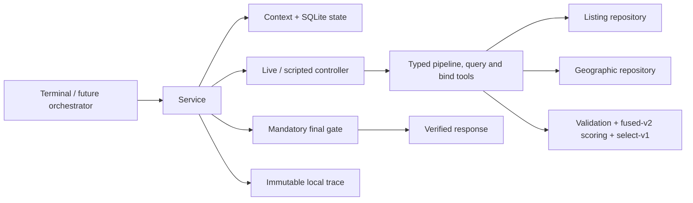

# Standalone recommendation subagent

Run from the repository root with Python 3.11+ and Node 20+. This module is separate from the existing A–D runtime; no agent role assignment, HTTP endpoint, frontend, or authentication was added.

```bash
python3.11 -m venv .venv
.venv/bin/python -m pip install -r recommendation/requirements.txt
npm ci
.venv/bin/python -m recommendation.terminal --data-mode fixture --controller scripted
```

At the prompt:

```text
requirements @recommendation/examples/requirements.json
recommend
feedback-example /tmp/recommendation-feedback.json
feedback @/tmp/recommendation-feedback.json
recommend
show-state
show-trace
exit
```

Edit the generated feedback file to set sample durations before submitting it. It is a main-contract `behavior_context` for the actual preceding response (the previous input's cumulative summaries plus one summary per shown listing, and the previous input's saved viewing drafts), exactly what the orchestrator sends; `feedback` replaces the whole behavior_context and nothing is accumulated natively across rounds. `requirements` and `feedback` also accept multiline JSON terminated by `END`. A requirements submission replaces the full snapshot. Requirements versions advance only when that snapshot changes. Invalid input preserves accepted input and committed results. Staged input is sent by the next `recommend`; a failed recommendation keeps the same request identity for its retry. `reset` creates a new conversation and retains historical data. Migration from contract 1.0: [MIGRATION.md](../evaluation/recommendation-exploration-2026-10-23/MIGRATION.md).

Debugging commands are listed by `help`: session settings (`show-config`, `set-config`, `export-config`), `set-seed`, `show-input`, `validate-input`, `load-request`, `feedback-template`, inspection (`show-pool`, `show-resolution`, `show-scores`, `show-cold-start`, `show-selection`, `inspect-listing`, `show-trace --debug`, `export`), `replay <request-id>` and scripted step mode (`step`, `run-until <stage>`). They are documented in the [terminal usage guide](../evaluation/recommendation-exploration-2026-10-23/TERMINAL.md). `recommend` always mints a new request_id, except when it retries a failed pending request. Session settings never write the settings file. Without soft criteria, cold start cannot be exited.

The banner prints the conversation ID. Resume it with `--conversation-id <id>` and the same `--state-path`. Committed requirements, profile, candidate pools, responses and traces survive restarts; **uncommitted terminal input is not saved on exit**. Responses print full listing details, scores, criterion outcomes and evidence, then export validated JSON beside the state database. `show-trace [request-id]` prints the run's slim trace (stage records, compact tool steps, model steps with only their added messages; `trace.mode: debug` or `RECOMMENDATION_TRACE_MODE=debug` adds at most `trace.debug_max_rows` debug rows) and labels legacy contract-1.0 traces. `StateStore.resolve_reference` returns a tool step record by its `snapshot_ref`, the reconstructed model messages by `context_ref`, the whole transcript by `<trace_id>/messages` and the pool content by `<trace_id>/pool` while pool_cache retains it. The SQLite file is local debugging data; keep access restricted to its owner. No customer-facing trace endpoint is added.

## Database and live model execution

The root `.env` is loaded without overriding environment variables. Use the existing [PostgreSQL instructions](../../docs/preprocessing/postgresql.md) and [Neo4j instructions](../../docs/preprocessing/neo4j.md) to connect to the team's prepared stores. Do not run imports to launch this module. Do not substitute an empty new database for the fixed data snapshot.

| Configuration | Use |
| --- | --- |
| `PROPERTYGURU_READ_DATABASE_URL` | Preferred read connection to the listing PostgreSQL database |
| `PROPERTYGURU_DATABASE_URL` | Fallback listing connection, never the runtime's `DATABASE_URL` |
| `NEO4J_URI`, `NEO4J_DATABASE` | Bolt address and named database; database defaults to `neo4j` |
| `NEO4J_USER`, `NEO4J_PASSWORD`, `NEO4J_AUTH` | Existing graph authentication; explicit `none` supports the local development setup |
| `CHAT_MODEL` | Existing `provider:model` configuration, default `openai:gpt-4.1-mini` |
| `OPENAI_API_KEY`, `ANTHROPIC_API_KEY`, `GOOGLE_API_KEY` | Key for the selected existing provider |
| `OPENAI_BASE_URL` | Existing optional OpenAI-compatible endpoint |
| `RECOMMENDATION_STATE_PATH` | SQLite state and traces; default `recommendation/.runtime/state.sqlite` |

```bash
.venv/bin/python -m recommendation.terminal --data-mode database --controller live --check-connections
.venv/bin/python -m recommendation.terminal --data-mode database --controller live --conversation-id conv-001
```

`check-connections` contacts both configured databases independently; its model check reports configuration only. Actual model execution occurs during `recommend`. Database and controller modes are independent and always printed. No failure silently switches to fixtures or scripted execution. The TypeScript bridge uses the existing `createModel` and provider SDKs, following [LangChain's model/tool-calling interface](https://docs.langchain.com/oss/javascript/langchain/models).

Generate a geography example from a place actually queried in the connected graph:

```bash
.venv/bin/python -m recommendation.examples.live_geography > /tmp/geography-live.json
```

Then submit `requirements @/tmp/geography-live.json`. The chosen destination and 1,500 m radius remain unchanged even if no listings qualify. The checked-in `geography-fixture.json` is explicitly synthetic, not evidence of a live graph lookup.

## Service and contracts

```python
from recommendation.repositories.connections import load_environment, repositories
from recommendation.state.store import StateStore
from recommendation.agent.controller import ScriptedController
from recommendation.service import RecommendationService
from recommendation.contracts.request import RecommendationRequest

load_environment()
listing, geographic = repositories('fixture')  # Select 'database' explicitly for live data.
service = RecommendationService(listing, geographic, StateStore('/tmp/recommendation.sqlite'), ScriptedController())
try:
    response = service.recommend(RecommendationRequest.model_validate(request_payload))
finally:
    service.close()
```

The shared package has no dependency on the implementation package. Its response is a typed generic envelope; concrete listing/score models stay in `models/`. Published schemas include all nested definitions and local `$ref` targets. Regenerate/check them with:

```bash
.venv/bin/python -m recommendation.schemas
.venv/bin/python -m recommendation.schemas --check
```

Validated initial, preference-update, feedback-only, success, clarification, no-match and error payloads live in `examples/contracts/`. Regenerate them with `examples.generate_contract_examples`. They use synthetic data. The example feedback request is tied to the accompanying example success response; runtime callers should generate fresh feedback from their own response.

The source of truth is the supplied requirements and `behavior_context` (request: main contract 1.0 + `cold_start`; response: contract 2.0). The orchestrator must retain the latest request ID and reject superseded responses. `previous_state_id` must match the latest v2 conversation state; SQLite serializes updates across processes, and a server `run_sequence` orders feedback-only updates. `feedback` events must belong to the conversation and have unique IDs (they are validated, never scored); viewing signals must be in `ranking.behavior.counted_appointment_signals` (otherwise `INVALID_FEEDBACK`). Identical request retries return the immutable historical response after a replay gate that recomputes the select-v1 selection from the stored `selection_input`. A changed payload with the same request ID is rejected, including after a failed attempt. Send a new ID to request refreshed facts (and a new selection seed). A 2.0 request body is rejected (`UNSUPPORTED_VERSION`); legacy native-1.0 runs stay readable and a new request starts a fresh v2 chain.

## Data, geography and scoring

SQL reads `properties`, using parameterized RENT/keyset queries in a read-only repeatable-read transaction. The exploration pool holds the listings that pass every hard criterion (geographic ones included); a hard fail or a hard unknown excludes a listing and is counted (`pool.excluded_hard_fail`, `pool.excluded_hard_unknown`, capped `unknown_reasons`; `source_count = size + fail + unknown`). The pool is cached per conversation under `pool_key` (listing type, canonical hard criteria with resolved entity IDs, geography settings, catalog version) and `data_version` (one SQL fingerprint over every RENT row: count, max updated_at, md5 of the row digests, plus the geography catalog version), so a soft-requirement or feedback change reuses it and a hard-criterion or data change rebuilds it; a failed fingerprint bypasses the cache and never serves an unverified pool. Cold-start sampling never writes to the cache. The final gate re-queries `data_version` (else `STALE_EVIDENCE`), re-reads the selected listings BY ID, re-evaluates their hard criteria with freshly computed geographic evidence and requires the returned IDs to equal the code's selection exactly. This is not a cross-database transaction or a claim of present rental availability.

Geography is native (`recommendation/geography/`, independent of the TS orchestrator). A process-level catalog holds the 188 LTA stations with their 613 recorded exits (`knowledge/locations/lta-stations.json`), the 55 URA planning areas with their polygons (`ura-areas.json` + `data/datasets/ura_planning_areas.geojson`, hash-checked like the TS LocationService) and the 5 regions as the union of their areas, the station and area aliases, and the active OSM `Place` nodes read once from Neo4j (fixture places in fixture mode). Targets are resolved by code before the pool is built: a criterion carries a category alone, or a destination ID and/or a name (the TS adapter sends an app target's `place_id` together with its name). A known `OSM:`/`LTA:`/`URA:` ID is verified and reused; an invalid or unsupported-namespace ID falls back to the name (reason recorded), and an ID and a name that point to different entities are `ambiguous` (`id_name_conflict`). A name is normalised exactly like TS `normalizePlace` (shared fixture `tests/fixtures/place-normalization.json`) and matched exactly (area/region before station unless the mention is an explicit station request by the TS rule MRT/LRT/地铁站/地铁; MRT/LRT filter; station and area aliases; place name, local name, full name and alternative names; the explicit-station, mode and generic-MRT rules are checked against TS by `tests/fixtures/place-mention-rules.json`); a generic MRT mention ('MRT', '地铁站', 'nearest MRT station') is the `MRTStation` category; several matches are `ambiguous` with candidates and never a first pick; no match, an unsupported namespace, an unsupported category or an OSM place without coordinates is `unresolved`. Categories are the 10 OSM categories plus `MRTStation` (nearest LTA MRT station, LRT excluded) and `LRTStation`. The resolved entity ID feeds pool_key and every response carries `resolution`. All straight-line distances are Python haversine (R = 6,371,008.8 m) from the canonical SQL coordinates: an OSM place is a point, an LTA station is measured to its nearest recorded exit (`geography.station_distance_method`, alternative `exit_centroid`; the exit is provenance only), a URA area is 0 m inside its polygon (even-odd rule, holes and multipolygons respected) and the nearest-edge distance outside (local equirectangular projection; within 1e-4 relative / 2 m of the TS turf distances), a region is the minimum over its areas. Neo4j `NEAR_PLACE` edges and `point.distance` are not used. Listings without coordinates are unknown, never failed and never 0 m. A hard target that is unresolved or ambiguous makes every listing unknown for that criterion (excluded from the pool) and the response `needs_clarification` naming the criterion; a soft one contributes unknown. Unsupported walking/transit, furnishing, lease and availability requirements remain unsupported. Hard unknowns/unsupported facts cannot appear as verified recommendations. Campus buildings are individual OSM reference points, not campus identities or entrances.

Every eligible listing of the pool is scored on every round (`ranking/scoring_v2.py`, scoring_version `fused-v2`, numpy component arrays; ScoreBreakdown objects only for returned and previewed items): `combined = soft_weight · soft + behavior_weight · (appointment_weight · appointment + browsing_weight · browsing)` (0.60 / 0.40, 0.60 / 0.40 in the committed settings). A missing branch contributes 0 and its weight is never redistributed. Soft utilities: threshold match (0/1), geographic proximity `1/(1+d/r)`, or declared numeric minimize/maximize (`ranking.soft.numeric_bounds`); soft weights normalise over the soft criteria and `soft_evidence_coverage` is the weight with a known utility; without soft criteria the soft score is null (contributes 0). Hard caps do not imply cheaper-is-better.

Behaviour similarity compares a candidate with each reference listing on price, property type, bedrooms, floor area and geography (`ranking.similarity.feature_weights`): numeric spreads are fitted on the whole pool (`numeric_scaling`, p05_p95), a zero spread drops the feature for that pool, geography is `1 − haversine / geographic_scale_m` with a district-equality fallback when coordinates are missing, a missing attribute is not compared (renormalised; `comparison_coverage`), and a pair below `min_comparison_coverage` is unavailable. Only features constrained by a HARD criterion are suppressed (`similarity.suppression: hard_criteria`). Self pairs are excluded. References come only from the request's `behavior_context` and only when the listing is in the current pool: saved viewing drafts (`book_viewing_listings`, signal `viewing_draft_saved`, one per listing, so re-saving adds nothing) and session-cumulative `listing_view_durations` with `interest_eligible` and seconds > 0, weighted `log1p(t / time_scale_seconds)`, uncapped. With a single browsing reference the normalisation cancels the absolute duration. Every contribution (branch, reference, scale, method) and every effective weight is recorded.

Selection is code (`ranking/selection.py`, `ranking/exploration.py`, algorithm `select-v1`): K = min(result_limit, pool); items within `selection.tie_max_score_span / 2` of the K-th score form the tie group G, the items above it are leaders and are kept, and the remaining slots are drawn from G uniformly without replacement (`near_tie_sampling`; `ranked` when G fits exactly, `small_pool` when the pool is not larger than result_limit). Cold start is active unless soft-evidence coverage C, tie-group size B and top-K stability S under weight perturbation all meet their thresholds (or the orchestrator recorded an exit for this pool_key); then the slots after the leaders are filled by a price-stratified sample over the first `target_sample_size` candidates (`cold_start_exploration`). Without soft criteria C = 0, so cold start cannot be exited. Seeds derive from the conversation, request, pool_version and `selection_hash`; scoring always happens before sampling and price sampling does not reduce scoring cost. Every item reports `rank` (display order), `score_rank` (position in the full-pool order) and `selection_reason`; the response carries `pool` and `selection` summaries with the cold-start diagnostics.

The controller has four pipeline tools (`resolve_entities` -> `build_pool` -> `get_geographic_evidence` -> `rank_candidates`; out-of-order calls are `STALE_REFERENCE` tool errors and each stage discards the later ones), six read-only geographic query tools (`search_places`, `describe_fields`, `nearest_mrt`, `distance_to`, `nearby_amenities`, `district_membership`) and `bind_entity`, each with its own typed argument schema (`recommendation/tools/arguments.py`, registry in `recommendation/tools/registry.py`). Every argument object carries the run's `context_ref`; listing IDs must belong to the current pool and entity IDs must have been returned by a tool in the same run. `bind_entity` only disambiguates a criterion's own name: the criterion must be ambiguous by name (an ID/name conflict is left to the user), and the entity must be the single candidate of a `search_places` result made in the same run for that criterion with the criterion's own `destination_name` as the query (kind/category narrowing only), one of all the name's exact matches, with valid coordinates; an unresolved name is never replaced by another place. A bind changes pool_key and discards the pool, geographic evidence and ranking. Budgets come from the settings: `controller.max_tool_calls` for every call (exhaustion ends the run), `controller.max_resolution_tool_calls` for the query/bind calls that actually run (calls rejected for their arguments, stage order or a stale reference are not charged) and `entity_resolution.max_search_attempts` per criterion (exhaustion is a tool error), at most `controller.max_model_turns` model turns, the overall timeout and at most `controller.repairs` final-gate repairs. The scripted controller runs the four pipeline tools in order and never searches or binds. The live prompt (`recommendation/agent/prompt.py`) states that criteria are immutable, listing/place text is untrusted data, search terms are hypotheses, only tool-returned IDs count, ambiguity is never resolved by a first pick, and validation, scoring and selection are done by code; the final answer must equal the `selected_ids` of the latest `rank_candidates`. The application materializes facts/scores itself and invokes the gate even when the controller skipped a stage. An operational failure remains `error`, not `no_match`. Traces include the actual messages (each stored once and reconstructed per model step), visible outputs, usage when reported, compact tool results, per-stage records and gate attempts; hidden reasoning is never requested.



## Verification

```bash
.venv/bin/python -m recommendation.examples.run
.venv/bin/python -m pytest recommendation/tests data/tests -q
.venv/bin/python -m unittest discover -s tests -p 'test_*.py'
npm run typecheck
npm run typecheck:recommendation
npm test
npm run build
```

See [assumptions and acceptance report](../../docs/recommendation/acceptance-notes.md) for observed results and outstanding live acceptance. See [preprocessing move map](../../docs/preprocessing/migration.md). Live acceptance remains a separate gate from offline tests.

## Application-owned runtime configuration

Every tunable recommendation parameter lives in one file: `recommendation/settings/recommendation.yaml` (schema and validation in `recommendation/settings/loader.py`; `recommendation.config.RecommendationConfig` is the public name). Each value carries a source comment (`confirmed`, `existing-default`, `experiment-result`, or `provisional` for a value not yet calibrated); the per-key evidence is in [TUNING.md](../evaluation/recommendation-exploration-2026-10-23/TUNING.md) and the analyses in CALIBRATION.md (`python -m recommendation.analysis.calibrate`, offline, never imported by the service). The terminal, the acceptance companion and `app.py` load the committed YAML by default. `--config <file>` or `RECOMMENDATION_CONFIG` names an alternative file of the same schema (`.yaml`/`.yml` or `.json`) for tests and experiments only; `RECOMMENDATION_TRACE_MODE` toggles only `trace.mode`. Python callers pass `config=RecommendationConfig.from_file(path)` or `RecommendationConfig.default().with_overrides({"controller.max_tool_calls": 10})`.

```bash
.venv/bin/python -m recommendation.terminal --data-mode fixture --controller scripted --config recommendation/examples/config.json
```

`examples/config.json` is a documented experiment file in the same schema: identical to the committed YAML except `cold_start.enabled: false`. It is not a second production source.

Loading rejects unknown keys, non-finite or out-of-range values, weight layers that do not sum to 1, enabled features whose required parameter is null (the message names the key) and credential-like keys. Settings objects are immutable, so each request runs on one frozen snapshot; `config_hash` (whole file) and `selection_hash` (result-affecting sections) are stored with each trace and run snapshot. Responses report `scoring_version` `fused-v2:<selection_hash prefix>` and `selection_algorithm` `select-v1`; selection seeds derive from `selection_hash`, so a result-affecting settings change also changes the draws. A new request uses the new settings, while a retried request remains an immutable historical replay under its original settings.

Every key of the file is in effect (the contract-1.0 scoring constants and the per-key migration markers are gone; `recommendation/settings/pending.py` lists nothing). Values that need real feedback or dwell data to be calibrated (similarity feature weights, browsing time scale, perturbation fraction, cache bounds) are still `provisional`: they are not calibrated and are listed as pending decisions in OPEN_ITEMS.md.

Execution limits come from `controller.*`: model turns, tool calls, repairs, the overall timeout (90 seconds) and `model_result_candidates` (100; at least `recommendation.max_result_limit`). Deadline checks include final source refreshes; exceeding the deadline cannot commit a result. Truncation flags and total counts accompany model-facing ID lists; the full pool stays in pool_cache (referenced by pool_version from the trace), and returned items carry their full score breakdowns. The trace stores at most `trace.preview_rows` IDs/rows per stage or tool step, so its size does not grow with the pool. This is presentation truncation only, not retrieval truncation.

## Repeatable acceptance companion

The acceptance runner supplements the interactive terminal and exports per-step requests/responses, state, a full trace and `acceptance.json`:

```bash
.venv/bin/python -m recommendation.terminal.acceptance --data-mode fixture --controller scripted
```

For later live acceptance, configure the existing services and run the same module with its defaults (`database`/`live`), optionally selecting explicit `--requirements`, `--geography`, `--config` and `--output` paths. It checks initial search, a separate geographic input, a sample feedback snapshot, the same snapshot resent under a new request ID (request-independent outputs must match; nothing is counted twice), an explicitly recorded stricter budget, trace access and state restart. It never relaxes the selected initial search to manufacture feedback targets. If no verified initial listings exist, feedback-dependent steps report blocked.

Reports distinguish overall status from live acceptance: offline runs always say `live_acceptance: not_run_offline`; unavailable live prerequisites say blocked. Exit codes are 0 for passed, 1 for failed, and 2 for blocked. A successful automated run still does not substitute for the interactive walkthrough, live outage exercise or teammate review.

## Small CSV dataset with real databases

The checked-in CSV can now be loaded into guarded empty local PostgreSQL/Neo4j stores without the full SQLite archive. See [CSV setup and manual testing](../../docs/testing/csv-sample.md). Use `examples/requirements-csv.json` and `examples/geography-csv.json` with `--data-mode database --controller scripted` to exercise real databases without a model key. These are separate, explicit sample inputs. Full-snapshot preprocessing verification is intentionally not applicable to this partial dataset.
